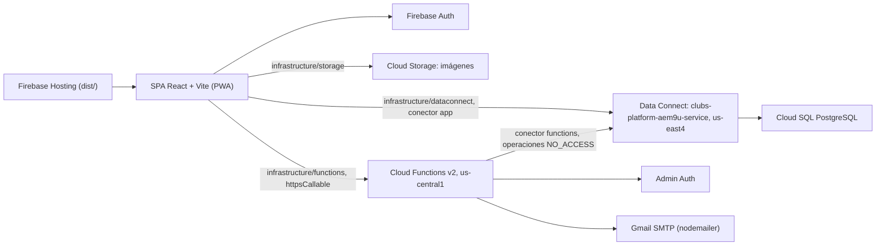
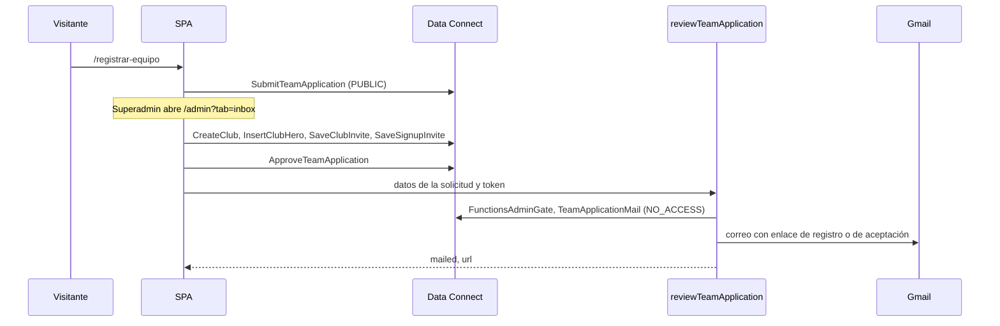

# Clubs Platform

Aplicación web para organizar una liga de fútbol amateur: clubes por localidad, temporadas, categorías, torneos con calendario y tabla, renta de canchas, y un panel por club para agenda, jugadores, finanzas e inventario.

[](https://react.dev/)
[](https://www.typescriptlang.org/)
[](https://vitejs.dev/)
[](https://firebase.google.com/)

**Sitio publicado:** [clubs-platform-aem9u.web.app](https://clubs-platform-aem9u.web.app) (proyecto Firebase `clubs-platform-aem9u`, definido en `.firebaserc`).

---

## Contenido

- [Overview](#overview)
- [Features](#features)
- [Architecture](#architecture)
- [Tech Stack](#tech-stack)
- [Requirements](#requirements)
- [Installation](#installation)
- [Configuration](#configuration)
- [Usage](#usage)
- [Development](#development)
- [Project Structure](#project-structure)
- [How It Works](#how-it-works)
- [API (Cloud Functions)](#api-cloud-functions)
- [Database](#database)
- [Authentication & Authorization](#authentication--authorization)
- [Testing, Linting & Type checking](#testing-linting--type-checking)
- [Build & Production](#build--production)
- [Deployment](#deployment)
- [Scripts](#scripts)
- [Troubleshooting](#troubleshooting)
- [Known Limitations](#known-limitations)
- [Contributing](#contributing)
- [License](#license)

---

## Overview

Clubs Platform es una SPA en React sobre tres servicios de Firebase:

- **Data Connect** (PostgreSQL en Cloud SQL) guarda todos los datos.
- **Cloud Storage** guarda las imágenes; SQL guarda sus URLs.
- **Firebase Auth** identifica a cada persona con correo y contraseña.

No hay Firestore en el código ni en `firebase.json`. La guardia `npm run check:firestore` corre en CI y falla si vuelve a aparecer.

Hay tres tipos de usuario:

- **Visitantes** (sin sesión): ven la portada, torneos, tablas, goleadores, calendario, directorio de equipos, partidos próximos, canchas en renta y la página pública de cada club (`/:slug`). Pueden mandar un mensaje de contacto o solicitar el registro de un equipo.
- **Miembros de un club** con rol `admin` (Presidente), `dt` (D. Técnico), `tesorero` o `prensa`: editan las secciones de su club que su rol permite.
- **Superadministradores de la plataforma** (tabla `platform_admins`): gestionan clubes, localidades, temporadas, categorías, torneos, partidos, canchas, anuncios, portada, bandeja de solicitudes y otros superadministradores desde `/admin`.

---

## Features

### Público

| Ruta | Qué ofrece |
|---|---|
| `/` | Portada con diseño «Carbón y Oro»: héroe con carrusel, temporada vigente, botones (inscribirse, registrar equipo, rentar cancha) y cifras reales de la vista `PlatformStat` (clubes activos, jugadores y canchas si la renta está activa); sección «En vivo» con el marcador y el minuto de los partidos de hoy; próximos partidos de 6 en 6 (en escritorio rotan cada 6 s; el superadmin los programa desde la tarjeta y la rotación se detiene mientras el formulario está abierto); torneos con pestañas «En curso / Próximos», fecha de inicio, equipos inscritos y premio al campeón (toda la tarjeta lleva al torneo; sus botones conservan su acción); y al final una franja negra de lado a lado con los anuncios de `home` a todo el ancho (rotan cada 5 s; en móvil la imagen llega a los bordes) o, sin anuncios vigentes, un bloque oscuro con la invitación a registrar ligas. Si nadie ha reclamado la plataforma, ofrece reclamar la administración. |
| `/torneos` | Archivo de torneos: en curso, próximos y finalizados, con el premio al campeón si tiene; toda la tarjeta lleva al torneo y sus botones («Quiero participar», «Editar», «Eliminar») conservan su acción. El superadmin puede borrar un torneo que no tenga partidos jugados. |
| `/torneos/:id` | Ficha del torneo: anuncio `tournament` al inicio, premio al campeón, tabla de posiciones con escudos, goleadores, calendario por jornada (fecha u “Por definir”), resumen de partido y podio cuando el torneo está finalizado y tiene podio guardado. |
| `/equipos` | Anuncio `teams` al inicio, directorio de clubes y posiciones por temporada y categoría. |
| `/partidos` | Próximos partidos con filtros por torneo y equipo, con la misma tarjeta de la portada («Hora por definir» si no tiene hora). La sede se arma con la cancha enlazada: ubicación y nombre («Col. Centro · Futbol 1»); sin cancha se muestra el texto guardado al programar. El superadmin los programa o reprograma desde la tarjeta. |
| `/partido/:id` | Página del partido: marcador, minuto y estado (por empezar, en vivo, por confirmar, final), cronología de goles y tarjetas, estadísticas, alineaciones en una cancha con la formación de cada club (con suplentes, su posición y el director técnico de la plantilla), y previa (posición en la tabla con puntos y desglose PJ·G·E·P·GF·GC·DG, últimos partidos, historial entre ambos y convocados). Las tarjetas de partido de la portada, de `/partidos` y del calendario del torneo llevan aquí. El superadmin ve el botón «Marcador en vivo». |
| `/canchas` | Elegir cancha (la tarjeta muestra nombre, ubicación si la tiene, descripción y costo), fecha, horario y duración según la apertura y los apartados. El botón final abre WhatsApp; elegir un horario **no** reserva nada en la base. Solo aparece si `courts_enabled` está activo. |
| `/contacto` | Formulario de contacto (se guarda en `inquiries`). |
| `/registrar-equipo` | Solicitud de alta de un equipo (se guarda en `team_applications` como pendiente). |
| `/:slug` | Página del club con pestañas `inicio`, `agenda`, `jugadores`, `finanzas`, `inventario` y `administradores` (`?seccion=`). La de administradores (miembros e invitaciones) solo la ven el presidente y el superadmin. |
| `/terminos`, `/aviso-de-privacidad` | Textos legales. |

### Cuentas

| Ruta | Qué ofrece |
|---|---|
| `/login` | Entrar con correo y contraseña. Acepta `?next=/ruta`. Incluye “olvidé mi contraseña”, que llama a `requestPasswordReset`. |
| `/registro` | Crear cuenta. Solo si el correo tiene una invitación en `signup_invites` o si la plataforma aún no tiene administrador. Acepta `?email=` y `?next=`. |
| `/restablecer` | Fijar una contraseña nueva con el `oobCode` del correo. |
| `/invitar` | Aceptar o rechazar una invitación a un club (`?c=&e=&t=`, y `&accion=rechazar`). Aceptar pide sesión con el mismo correo; sin sesión manda a `/login?next=`. |

**Selector de espacios.** Con sesión, la cabecera (la de la plataforma y la del club) muestra un selector al estilo de las cuentas de Instagram: la liga (`/`), el panel de administración (`/admin`, solo superadmin) y cada club donde el usuario tiene rol, con su rol. El espacio activo se deduce de la URL. En escritorio se abre como menú y en móvil como hoja inferior; también incluye «Cerrar sesión». En la cabecera del club el selector sustituye a la píldora de rol; desde ahí se vuelve a la liga.

### Club (`/:slug`), según rol

- **Inicio:** cumpleaños, portada (imágenes del héroe), récord del equipo, vitrina de trofeos, salón de la fama y galería por álbumes. Editar portada y galería requiere `canEditPortada`.
- **Agenda:** entrenamientos, amistosos y partidos oficiales; asistencia, alineación, marcador, álbum y estadísticas del evento. Desde aquí se guarda la **disponibilidad semanal** del club, que se usa para sugerir fechas de partido.
- **Jugadores:** plantilla, estadísticas, comparación y ficha con foto.
- **Finanzas:** resumen, movimientos (ingresos y gastos), metas con aportación por jugador.
- **Inventario:** material por estado (`BUENO`, `MALO`, `PERDIDO`).
- **Miembros:** modal en el encabezado del club para invitar, cambiar roles y cancelar invitaciones (solo Presidente o superadmin).

### Superadministración (`/admin?tab=`)

`clubs`, `competition` (temporadas, categorías, torneos), `cover` (portada y marca de la plataforma), `ads` (anuncios por ubicación `home`, `tournament`, `club`, `teams`; la vigencia la deciden las fechas de inicio y fin, «Pausar» es el único freno manual y un anuncio programado sale solo cuando llega su fecha), `inbox` (contactos y solicitudes de equipo), `admins` (superadministradores e invitaciones) y `courts` (canchas con nombre, descripción, ubicación opcional, costo, foto y si es apta para torneos; horario de apertura, bloque de 30 o 60 minutos, apartados manuales y edición de los apartados de partido).

En la ficha del torneo el superadministrador además edita el torneo, suma equipos (genera los partidos, uno o ida y vuelta según `legs`), programa fecha, hora y cancha, y captura marcador, goles y tarjetas.

### Correo

Las Cloud Functions envían correos HTML y texto para: invitación a un club, invitación a superadministrador, restablecer contraseña, aviso de renta de cancha (alta, cambio, cancelación), equipo aprobado, equipo rechazado, inscripción a torneo y programación o cambio de partido. Plantillas en [`functions/src/mail.ts`](functions/src/mail.ts).

### PWA

`vite-plugin-pwa` genera el manifiesto y el service worker con `registerType: "autoUpdate"`. Nombre, nombre corto y descripción salen de [`src/domains/clubs/clubDefaults.ts`](src/domains/clubs/clubDefaults.ts); el ícono es `public/icon.svg`. El modo es `generateSW`: `dist/sw.js` precachea los archivos del build. Los datos (Data Connect y Functions) siguen necesitando conexión.

---

## Architecture



- **Cliente.** Solo `src/infrastructure/` importa `firebase/*` o `dataconnect/generated`. [`firebase.ts`](src/infrastructure/firebase.ts) inicializa Auth, Storage y Functions (`us-central1`); [`dataconnect.ts`](src/infrastructure/dataconnect.ts) crea la instancia de Data Connect y reexporta el SDK generado.
- **Data Connect.** [`dataconnect/dataconnect.yaml`](dataconnect/dataconnect.yaml) apunta a la base `clubs-platform-aem9u-database` de la instancia `clubs-platform-aem9u-instance` y declara dos conectores:
  - `app` (`dataconnect/connector/*.gql`, 47 queries y 97 mutations): lo usa el navegador con `@auth(level: PUBLIC)` o `USER`. Genera el SDK en `dataconnect/generated`.
  - `functions` (`dataconnect/functions/functions.gql`, 7 queries y 2 mutations): todas `@auth(level: NO_ACCESS)`. Solo las ejecuta el Admin SDK desde las funciones, que así leen de SQL los datos del correo en vez de confiar en lo que manda el cliente.
- **Cloud Functions.** Siete *callables* en [`functions/src`](functions/src). No hay triggers. Validan permisos con la operación `FunctionsAdminGate` ([`sql.ts`](functions/src/sql.ts)).
- **Hosting.** Sirve `dist/` y reescribe toda ruta a `/index.html` ([`firebase.json`](firebase.json)).

### Capas de `src/`

`app` → `features` → `domains` → `infrastructure` → `shared`. Cada capa importa solo de las que están a su derecha.

- `features/<pantalla>/`: `use<Pantalla>.ts` ejecuta la query, `<pantalla>Mapper.ts` arma solo lo que se pinta, `<pantalla>ViewState.ts` tipa la vista y `<Pantalla>View.tsx` la dibuja.
- `domains/<dominio>/`: reglas y comandos (`*Commands.ts`) que llaman las mutaciones. Tras una mutación, la lectura que refresca usa `QueryFetchPolicy.SERVER_ONLY`; si la mutación devuelve `null`, el guardado falló.

---

## Tech Stack

Versiones resueltas en `package-lock.json` y `functions/package-lock.json`.

| Área | Tecnología |
|---|---|
| Lenguaje | TypeScript (raíz `typescript` 7.0.2; funciones `typescript` ^5.9.2) |
| UI | React 18.3.1, React Router DOM 7.18.4, `lucide-react`, CSS global (`src/index.css`) |
| Build | Vite 5.4.21, `@vitejs/plugin-react`, `vite-plugin-pwa` 1.3.0 |
| Imágenes | `browser-image-compression` antes de subir a Storage |
| SDK cliente | `firebase` 12.17.1 (Auth, Storage, Functions, Data Connect) |
| Base de datos | Firebase Data Connect sobre Cloud SQL for PostgreSQL |
| Backend | Cloud Functions v2 (`firebase-functions` ^6.4.0, `firebase-admin` ^14.5.0), Node 20 |
| Correo | `nodemailer` ^10 vía Gmail SMTP |
| CI/CD | GitHub Actions + `FirebaseExtended/action-hosting-deploy@v0` |

---

## Requirements

- **Node.js 20**, el runtime que declaran las funciones (`"engines": { "node": "20" }`).
- **npm** (hay `package-lock.json` en la raíz y en `functions/`).
- **Firebase CLI** (`firebase-tools`), instalada aparte, para generar el SDK de Data Connect y desplegar.
- Un proyecto de Firebase con Authentication (correo/contraseña), Cloud Storage, Cloud Functions y Data Connect con su instancia de Cloud SQL.
- Opcional: una cuenta de Gmail con contraseña de aplicación para que las funciones envíen correo.

---

## Installation

```bash
git clone https://github.com/CarlosQuinto/clubs-platform.git
cd clubs-platform

npm install
npm --prefix functions install

cp .env.example .env
# completa los valores VITE_FIREBASE_* (ver Configuration)

npm run dev
```

Vite sirve la app en `http://localhost:5173`. El SDK de Data Connect está generado y versionado en `dataconnect/generated`; `src/infrastructure/dataconnect.ts` lo importa por ruta relativa, así que no hace falta instalarlo como paquete.

En desarrollo la app se conecta al proyecto de Firebase de `.env` (no hay emuladores configurados en `firebase.json`). Para probar operaciones del conector sin tocar producción, `firebase emulators:start --only dataconnect` levanta Data Connect en `127.0.0.1:9399` con un Postgres local.

---

## Configuration

### Aplicación web (`.env` en la raíz)

Se leen con `import.meta.env` en [`src/infrastructure/firebase.ts`](src/infrastructure/firebase.ts). Salen de Consola de Firebase → Configuración del proyecto → Tus apps.

| Variable | Obligatoria | Descripción | Ejemplo |
|---|---|---|---|
| `VITE_FIREBASE_API_KEY` | Sí | API key de la app web | `AIza...` |
| `VITE_FIREBASE_AUTH_DOMAIN` | Sí | Dominio de Auth | `your-project-id.firebaseapp.com` |
| `VITE_FIREBASE_PROJECT_ID` | Sí | ID del proyecto | `your-project-id` |
| `VITE_FIREBASE_STORAGE_BUCKET` | Sí | Bucket de Storage | `your-project-id.firebasestorage.app` |
| `VITE_FIREBASE_MESSAGING_SENDER_ID` | Sí | Sender ID | `123456789012` |
| `VITE_FIREBASE_APP_ID` | Sí | App ID web | `1:123456789012:web:abc123` |

Si falta alguna, la consola muestra `[firebase] Faltan variables de entorno para: ...` y la app intenta arrancar igual.

### Cloud Functions (`functions/.env`)

Plantilla en [`functions/.env.example`](functions/.env.example). `functions/.env` está en `.gitignore`.

| Variable | Obligatoria | Descripción | Ejemplo |
|---|---|---|---|
| `APP_URL` | No | URL base para los enlaces de los correos. Por defecto `https://clubs-platform-aem9u.web.app`. | `https://your-project-id.web.app` |
| `GMAIL_USER` | No | Cuenta remitente. Sin ella y sin la siguiente no se envía ningún correo. | `notificaciones@example.com` |
| `GMAIL_APP_PASSWORD` | No | Contraseña de aplicación de esa cuenta; se le quitan los espacios. | `abcdabcdabcdabcd` |
| `WEB_API_KEY` | No | API key web. Solo la usa `requestPasswordReset` cuando Gmail no está configurado, para que Firebase mande su correo estándar. | `AIza...` |

### GitHub Actions

| Nombre | Tipo | Uso |
|---|---|---|
| `FIREBASE_SERVICE_ACCOUNT` | Secret | JSON de cuenta de servicio. Sin él, el workflow compila y omite el despliegue. |
| `VITE_FIREBASE_*` (las seis de arriba) | Secrets | Se inyectan en `npm run build`. |
| `FIREBASE_PROJECT_ID` | Variable | Proyecto destino del despliegue. |

### Constantes de marca

[`src/domains/clubs/clubDefaults.ts`](src/domains/clubs/clubDefaults.ts) define `PLATFORM_NAME` (“Clubs Platform”), `PLATFORM_SHORT_NAME`, `PLATFORM_DESCRIPTION`, las imágenes de portada por defecto y los valores iniciales de un club. `vite.config.ts` las usa para el manifiesto PWA. El nombre, lema, logo y redes que se ven en la app se editan en `/admin?tab=cover` y se guardan en `platform_settings`.

---

## Usage

Primer arranque en un proyecto vacío:

1. Abre `/registro` y crea la primera cuenta. Si `platform_admins` está vacía (vista `PlatformClaimState`), el registro llama a `BootstrapPlatformAdmin` y esa cuenta queda como superadministrador. La portada también ofrece reclamar la administración mientras nadie lo haya hecho.
2. En `/admin?tab=competition` crea temporadas (solo números y guion, hasta 11 caracteres), categorías y torneos. Crear un torneo lleva a `/torneos`. El **premio al campeón** es opcional y se aplica a todas las categorías elegidas; después se cambia por categoría en «Editar torneo».
3. En `/admin?tab=clubs` crea clubes (nombre, URL y localidad son obligatorios) o aprueba solicitudes en `/admin?tab=inbox`. Al aprobar se crea el club y se invita por correo al capitán como Presidente.
4. En la ficha del torneo suma equipos para generar los partidos, programa fecha, hora y cancha, y captura marcadores.
5. Opcional: en `/admin?tab=courts` da de alta canchas y el horario de apertura, y activa el módulo público de canchas.
6. Cada Presidente invita a su cuerpo técnico desde **Miembros** en la página de su club.

---

## Development

```bash
npm run dev                        # servidor de Vite
npm run build                      # build de producción en dist/
npm run preview                    # sirve dist/ localmente
npx tsc --noEmit                   # tipos del frontend
npm --prefix functions run build   # compila functions/src a functions/lib
npm run check:firestore            # falla si reaparece Firestore
```

### Cambiar el esquema o el conector de Data Connect

- Esquema: [`dataconnect/schema/schema.gql`](dataconnect/schema/schema.gql). Conector `app`: `dataconnect/connector/{queries,mutations,admin,league,club}.gql`. Conector `functions`: `dataconnect/functions/functions.gql`.
- Tras cambiar operaciones del conector `app`, regenera el SDK con `firebase dataconnect:sdk:generate` y despliega con `firebase deploy --only dataconnect`.
- `schemaValidation: "COMPATIBLE"`: quitar un campo, una variable obligatoria o una operación rompe a los clientes ya publicados. Para retirar una operación usa `@retired`, o confirma el despliegue con `--force` si ningún cliente la llama.

Convenciones del conector:

- Las escrituras de superadmin verifican `platformAdmin(key: { userId: $userId }) @check(...)` y luego ejecutan SQL nativo con `INSERT ... VALUES`, `UPDATE` o `DELETE`.
- Las escrituras de club validan el rol en SQL con `EXISTS (SELECT 1 FROM club_members ... role IN (...))` usando `{ _expr: "auth.uid" }`.
- Enums con cast (`'PLAYED'::match_status`), booleanos como parámetro, `CURRENT_TIMESTAMP` en columnas obligatorias y placeholders de `$1` a `$9`.
- Una relación del esquema (`invitedBy: User`) es la columna `invited_by_id` en SQL.
- `_executeReturningFirst` envuelve el SQL en `WITH "cte_0" AS (<sql>) SELECT ...`. Dentro de ese SQL no puede haber un `WITH` que modifique datos: Postgres lo rechaza y el cliente solo ve `SQL execution failed`. Las CTE de solo lectura sí funcionan.
- Una mutación con varios pasos se escribe como varios campos: los primeros con `_execute` (que sí admite CTE que modifican) y el último con `_executeReturningFirst`. **Sin `@transaction`**: con esa directiva Data Connect junta todos los campos en una sola sentencia y cualquier `_execute` la rompe. Sin ella, los campos corren en orden y un `@check` que falla detiene los siguientes. Ordena los pasos para que repetir la operación sea seguro.
- Comprobar el correo de la sesión: `query @redact { invitacion(...) @check(expr: "this == null || this.email == auth.token.email", message: ...) { email } }`. El `@check` va sobre el objeto, no sobre un campo de texto.

---

## Project Structure

```text
clubs-platform/
├── .github/workflows/
│   ├── firebase-hosting-merge.yml         # push a main → check:firestore, build, Hosting live
│   └── firebase-hosting-pull-request.yml  # PR → check:firestore, build, canal de vista previa
├── dataconnect/
│   ├── dataconnect.yaml        # servicio, región, Cloud SQL, conectores
│   ├── schema/schema.gql       # tablas, enums y vistas SQL
│   ├── connector/              # conector "app" (navegador)
│   ├── functions/              # conector "functions" (NO_ACCESS, Admin SDK)
│   └── generated/              # SDK JS generado (versionado)
├── functions/src/
│   ├── index.ts                # invitaciones, solicitudes, renta de cancha, contraseña
│   ├── notices.ts              # avisos de partido programado e inscripción a torneo
│   ├── sql.ts                  # cliente del conector functions y comprobación de permisos
│   └── mail.ts                 # plantillas y envío por Gmail
├── public/icon.svg
├── scripts/checkFirestore.mjs  # guardia de CI
├── src/
│   ├── main.tsx
│   ├── app/                    # rutas (App.tsx) y marca del documento
│   ├── features/               # una carpeta por pantalla
│   │   ├── admin/              # /admin y sus pestañas (admins, ads, competition, courts, cover, inbox)
│   │   ├── auth/               # login, registro, restablecer, /invitar
│   │   ├── club/               # /:slug con agenda, finanzas, inicio, inventario y jugadores
│   │   ├── tournament/         # /torneos y /torneos/:id
│   │   ├── home/ contact/ courts/ matches/ teams/ registerTeam/ legal/
│   │   └── shell/              # layout, encabezado, anuncios, carruseles
│   ├── domains/                # reglas y comandos por dominio
│   │   ├── auth/               # AuthContext, roles, destinos tras el login
│   │   ├── clubs/              # ClubContext, invitaciones, valores por defecto
│   │   ├── competition/        # calendario (fixtures), estadísticas, comandos
│   │   ├── courts/ matches/ finances/ platform/
│   ├── infrastructure/         # firebase, dataconnect, auth, storage/uploadImage, functions/callables
│   └── shared/                 # ui, tipos, rutas, límites de texto, utilidades
├── firebase.json               # hosting, functions, storage, auth, dataconnect
├── storage.rules
├── vite.config.ts
└── package.json
```

---

## How It Works

### Sesión y rol de superadministrador

1. `AuthProvider` ([`src/domains/auth/AuthContext.tsx`](src/domains/auth/AuthContext.tsx)) escucha la sesión de Firebase Auth.
2. Con sesión, consulta `PlatformAdminById`. `isSuperAdmin` es verdadero solo si hay fila en `platform_admins`; mientras la consulta no responde, `/admin` espera.
3. Al entrar o registrarse ejecuta `EnsureMyProfile` (fila en `users`) y `ClaimPlatformAdminInvite`, que convierte en superadmin a quien tenga una invitación en `platform_admin_invites` para su correo.
4. Después del login, [`destinations.ts`](src/domains/auth/destinations.ts) acepta las invitaciones de club abiertas para ese correo (`MyOpenClubInvites` + `AcceptClubInvite`) y decide a dónde llevar al usuario.
5. El selector de espacios lee los clubes con `MySpaces`, que filtra por `auth.uid` en el servidor ([`mySpaces.ts`](src/domains/auth/mySpaces.ts)). La lista se guarda en memoria, compartida entre cabeceras, y se vuelve a consultar al abrir el selector, al aceptar una invitación, al cambiar roles y al guardar el perfil del club. Antes de publicar un cliente que use `MySpaces`, despliega Data Connect.

### Invitaciones

Todo vive en SQL: `club_invites`, `platform_admin_invites` y `signup_invites` (esta última habilita `/registro`).

- **Club.** El Presidente invita desde Miembros: `SaveClubInvite` guarda la invitación con un token y `sendClubInvite` manda el correo. Si el correo ya tiene cuenta, el enlace va a `/invitar`; si no, a `/registro`. `/invitar` lee la invitación con `ClubInviteLookup`, acepta con `AcceptClubInvite` (exige que la sesión sea del correo invitado) y rechaza con `DeclineClubInvite` (basta el token).
- **Superadmin.** `SavePlatformAdminInvite` + `SaveSignupInvite` y el correo de `sendPlatformAdminInvite`. Se reclama al entrar con ese correo. `RemovePlatformAdminInvite` la cancela.

### Solicitud de equipo hasta su club



Al rechazar, la app ejecuta `RejectTeamApplication` y la función manda el correo de rechazo.

### Programar un partido y la tabla

- La ficha del torneo, la portada y `/partidos` usan el mismo formulario (`features/matches/MatchScheduleForm.tsx`). Ofrece las canchas con `football` y `active` verdaderos, libres en la apertura y sin un apartado que se cruce; cada opción se lee «ubicación · nombre» (`courtPlaceLabel` en `domains/courts/courts.ts`), igual que la sede en las tarjetas de partido y en `/partido/:id`. En `matches.venue` se sigue guardando solo el nombre de la cancha, como respaldo cuando el partido no tiene cancha enlazada. El partido que se edita no choca consigo mismo. Las tres fechas sugeridas salen de la disponibilidad de ambos clubes, la apertura y los partidos que ya tienen.
- Al guardar, si la cancha ya no está libre, no se guarda y se muestra “Esa cancha no está disponible en esa fecha y hora.” Lo mismo vale al editar el apartado de un partido en `/admin?tab=courts`.
- Después de programar, la app llama a `sendMatchScheduleNotice`. La función lee el partido con `MatchScheduleNotice` y compara fecha, hora y cancha con `matches.schedule_notice_key`. Solo si cambiaron, avisa a los Presidentes de ambos clubes y actualiza la llave con `MarkMatchScheduleNotice`.
- Al sumar equipos a un torneo, la app llama a `sendTournamentEnrollmentNotice`. La función inserta en `tournament_notices` con `RecordTournamentNotice` y solo manda el correo si la fila es nueva, así que cada club recibe el aviso una vez.
- La tabla de posiciones y los goleadores no se guardan: son vistas SQL (`TournamentStanding`, `TournamentScorer`) sobre los partidos `PLAYED`. Victoria 3, empate 1; desempate por puntos, diferencia, goles a favor e ID de club. Los próximos partidos salen de la vista `MatchListing`.

### Partidos en vivo

- La sección «En vivo» de `/` lee los partidos de ayer y hoy con `LiveMatches` (pública). Un partido está **en vivo** desde su hora de inicio hasta inicio + `tournaments.duration_minutes` + 3 minutos de margen (`LIVE_MARGIN_MINUTES` en `domains/matches/liveMatchPhase.ts`, igual para todos los torneos). Después aparece como **Terminado**, con su resultado, hasta el fin del día. La fase se calcula en el navegador con la hora local; no hay estado «en curso» en `matches`.
- El margen ya no se guarda por torneo ni se edita en «Editar torneo».
- **Premio al campeón** (`tournaments.prize`, texto libre, vacío = sin premio): hasta 60 caracteres, letras, números y `. , + $ / ( ) -`, sin dobles espacios. La misma regla está en `tournamentPrize()`/`isTournamentPrize()` (`textLimits.ts`) y en el SQL de `CreateTournament` y `UpdateTournamentSettings`. `CreateTournament` ya ocupa `$1`–`$9` en el INSERT, así que valida el premio en el paso `grouped` (sin grupo, el INSERT falla por llave foránea antes de escribir) y lo guarda en el último paso `prized`. Sin `$prize` (clientes anteriores) `UpdateTournamentSettings` conserva el guardado.
- **Marcador en vivo.** Desde `/partido/:id`, el superadmin registra cada gol (normal, penal, autogol o «Sin asignar») y cada tarjeta al momento, con su minuto. El minuto se calcula con la hora de inicio programada y se puede corregir. Usa `AddLiveMatchGoal`, `DeleteLiveMatchGoal`, `AddLiveMatchCard` y `DeleteLiveMatchCard`:
  - Mientras el partido sigue `SCHEDULED`, cada cambio recalcula `home_score`/`away_score` contando las filas de `match_goals`. El autogol se guarda en el `club_id` del equipo al que se le suma y lo marca un jugador rival.
  - La tabla y los goleadores solo cuentan `PLAYED`, así que el marcador parcial no los toca.
  - El id del evento lo genera el navegador (`crypto.randomUUID()`) y el SQL usa `ON CONFLICT (id)`, de modo que reintentar no lo duplica.
- **Finalizar partido** (`FinishLiveMatch`) recalcula el marcador, deja el partido en `PLAYED` y activa el torneo si seguía próximo.
- Después de finalizar ya no hay edición en vivo. Las correcciones se hacen con «Marcador» en la ficha del torneo:
  - Cada «Guardar» de ese modal deja el partido en `PLAYED`.
  - El modal reescribe goles y tarjetas y conserva su minuto (`InsertTimedMatchGoal`, `InsertMatchCard` con `$minute`).
  - No se puede reabrir un partido.
- **Permisos.** Las mutaciones en vivo comprueban `platformAdmin(key: { userId_expr: "auth.uid" })`, es decir, el uid de la sesión, no uno enviado por el cliente.
- **Sondeo.**
  - La portada vuelve a consultar cada 15 s solo mientras hay un partido en vivo (o a punto de empezar) y la pestaña está visible, y también al volver a la pestaña.
  - La página del partido (`MatchDetail`, pública) hace lo mismo desde 2 min antes del inicio hasta una hora después de la hora de fin, mientras no esté finalizado (`shared/useVisibleInterval.ts`). Un partido cuya hora ya pasó pero sigue `SCHEDULED` se muestra «Por confirmar».
  - La previa (`MatchPreview`) se pide una vez y otra al cambiar el estado.
- **Minutos.** `match_goals.minute` y `match_cards.minute` son opcionales; los eventos anteriores no tienen minuto y van al final de la cronología.
- **Alineaciones.** Son las que guarda cada club en `match_club_reports.lineup` (`{mode, formation, positions}`). Las coordenadas de las formaciones están en `domains/matches/formations.ts`, compartidas con la pizarra del club.

---

## API (Cloud Functions)

No hay endpoints REST ni triggers. El cliente llama funciones *callable* desde [`src/infrastructure/functions/callables.ts`](src/infrastructure/functions/callables.ts); todas están en `us-central1` con `cors: true`.

| Función | Auth | Qué hace |
|---|---|---|
| `sendClubInvite` | Sesión + Presidente del club o superadmin | Manda el correo de una invitación ya guardada en SQL. Lee club, rol y token con `ClubMailInfo`. |
| `sendPlatformAdminInvite` | Sesión + superadmin | Manda el correo de invitación a superadministrador. |
| `reviewTeamApplication` | Sesión + superadmin | Manda el correo de solicitud aprobada o rechazada. |
| `sendMatchScheduleNotice` | Sesión + superadmin | Avisa a ambos clubes que su partido quedó programado o cambió. No repite el aviso si nada cambió. |
| `sendTournamentEnrollmentNotice` | Sesión + superadmin | Avisa una sola vez a cada club recién inscrito para que cargue su disponibilidad. |
| `sendCourtBookingNotice` | Sesión | Correo de renta de cancha: `created`, `updated` o `cancelled`. |
| `requestPasswordReset` | Ninguna | Si el correo tiene cuenta, manda el enlace a `/restablecer`. Siempre responde `{ ok: true }`. |

Ejemplo del cliente:

```ts
import { notifyMatchScheduled } from "../../infrastructure/functions/callables";

// Llama a sendMatchScheduleNotice sin esperar: si el correo falla, el partido ya quedó guardado.
notifyMatchScheduled(matchId);
```

Los errores son `HttpsError` con códigos `unauthenticated`, `permission-denied`, `invalid-argument`, `not-found` o `failed-precondition` y mensajes en español. Si Gmail no está configurado, las funciones responden `mailed: false` y la operación de datos queda guardada.

---

## Database

Todo está en PostgreSQL, definido en [`dataconnect/schema/schema.gql`](dataconnect/schema/schema.gql). Los `id` de tipo `String` de las filas migradas conservan el ID que tenían en Firestore; las horas `HH:mm` se guardan como `varchar(5)`.

| Dominio | Tablas |
|---|---|
| Plataforma | `users`, `platform_settings`, `platform_admins`, `platform_admin_invites`, `platform_hero_images`, `court_open_windows`, `signup_invites`, `email_outbox` (histórico migrado, sin escrituras) |
| Competición | `localities`, `categories`, `seasons`, `tournament_groups`, `tournaments`, `tournament_clubs`, `tournament_podium`, `tournament_notices` |
| Partidos | `matches`, `match_club_reports`, `match_attendees`, `match_goals`, `match_cards`, `match_goalkeepers` |
| Canchas | `courts` (nombre y descripción de 3 a 15, ubicación opcional de 3 a 60), `court_holds` |
| Clubes | `clubs`, `club_hero_images`, `club_availability_windows`, `club_default_lineups`, `club_members`, `club_invites`, `players` |
| Agenda del club | `club_events`, `club_event_attendees`, `club_event_goals`, `club_event_cards`, `club_event_goalkeepers`, `club_event_photos` |
| Finanzas e inventario | `transactions`, `financial_goals`, `goal_contributions`, `inventory_items` |
| Galería | `albums`, `gallery_photos` |
| Anuncios y entrada | `ads`, `ad_placements`, `inquiries`, `team_applications` |

**Eliminar un club es un borrado lógico** (`DeleteClub`): se borran sus invitaciones pendientes (`club_invites`, `signup_invites`) y se marca `clubs.deleted_at` con `active = false`. El club desaparece de `/admin`, del directorio, del selector de torneos y del selector de espacios, y `/<slug>` muestra «Club no encontrado». Sus jugadores, partidos, podios y finanzas se conservan, así que la tabla, los goleadores y el historial de los rivales no cambian. El slug queda reservado. Los miembros se conservan sin acceso; para restaurar el club: `UPDATE clubs SET deleted_at = NULL, active = true WHERE slug = '<slug>';`.

Desactivar un club (botón del ojo en `/admin`) pone `clubs.active = false` y exige un motivo en `clubs.disabled_reason` (de 5 a 100 caracteres, letras, números y `. , : ; ¡ ! ¿ ? ( ) ' " -`, sin dobles espacios; la misma regla en `textLimits.ts` y en el SQL de `SetClubActive`). El club sale de `/equipos`, del registro de equipos y de la inscripción a torneos, pero su página sigue abierta y muestra a todos un aviso con el motivo y un enlace a `/contacto`. Activarlo borra el motivo.

Enums principales: `MemberRole` (`ADMIN`, `DT`, `PRENSA`, `TESORERO`), `TournamentStatus` (`UPCOMING`, `ACTIVE`, `FINISHED`), `MatchStatus` (`UNSCHEDULED`, `SCHEDULED`, `PLAYED`), `FootballType` (`FUT_7`, `FUT_9`, `FUT_11`), `CourtHoldSource` (`MATCH`, `MANUAL`), `AdStatus`, `AdPlacementKind`, `TeamApplicationStatus`, `InviteKind`.

Vistas SQL (`@view`):

| Vista | Contenido |
|---|---|
| `PlatformClaimState` | `open = true` si `platform_admins` está vacía |
| `PlatformStat` | Cifras de la portada: clubes activos, jugadores activos (sin cuerpo técnico) de esos clubes y canchas activas |
| `MatchListing` | Partidos `SCHEDULED` con fecha y hora, con `starts_at` para ordenar |
| `TournamentStanding` | PJ, G, E, P, GF, GC, DG, puntos y posición por torneo |
| `TournamentScorer` | Goles y asistencias por jugador (sin autogoles) |
| `ClubLedger` | Movimientos del club más aportaciones a metas |
| `PlayerContributionTotal` | Total aportado por jugador |

Las imágenes están en Storage bajo `platform/**` y `clubs/{clubId}/{logos|portada|gallery|players|events}/**`; SQL guarda sus URLs.

La base Firestore anterior puede seguir existiendo en el proyecto como respaldo; ni la app ni las funciones la usan. `firebase.json` ya no despliega sus reglas, así que antes de dejarla conviene confirmar en la consola que sus reglas nieguen todo, o borrarla.

---

## Authentication & Authorization

- **Autenticación:** Firebase Auth con correo y contraseña. El registro está limitado a correos invitados, salvo el primer usuario.
- **Superadmin:** fila en `platform_admins`. No hay otra fuente.
- **Roles de club** ([`src/domains/auth/roles.ts`](src/domains/auth/roles.ts), `buildPerms`), leídos de `club_members` con la query `ClubScreen`:

| Rol | Portada y galería | Agenda | Jugadores | Finanzas | Inventario | Miembros |
|---|:-:|:-:|:-:|:-:|:-:|:-:|
| Superadmin / `admin` (Presidente) | ✓ | ✓ | ✓ | ✓ | ✓ | ✓ |
| `dt` (D. Técnico) | | ✓ | ✓ | | ✓ | |
| `tesorero` | | | | ✓ | ✓ | |
| `prensa` | ✓ | | | | | |

- **Data Connect:** la comprobación real ocurre en el servidor. Las mutaciones de plataforma exigen `platformAdmin(...) @check`; las de club filtran con `EXISTS` sobre `club_members` y `auth.uid`. Las lecturas públicas y los envíos públicos (`SubmitInquiry`, `SubmitTeamApplication`, `DeclineClubInvite`) usan `@auth(level: PUBLIC)`. Las operaciones del conector `functions` son `NO_ACCESS`.
- **Storage** ([`storage.rules`](storage.rules)): lectura pública; escritura para cualquier sesión, solo imágenes de menos de 5 MB. Qué club puede usar la imagen lo decide la mutación que guarda la URL.
- **Funciones:** validan `request.auth`, el formato del correo y el rol con `FunctionsAdminGate`. Los tokens de invitación son un `crypto.randomUUID()` sin guiones (32 caracteres hexadecimales) generado en el navegador.

No hay rate limiting, App Check ni CSRF configurados en el repositorio.

---

## Testing, Linting & Type checking

- **Tests:** no hay tests ni runner configurado.
- **Lint y formato:** no hay ESLint ni Prettier.
- **Tipos:** `npm run build` ejecuta solo `vite build`, que no comprueba tipos. `npx tsc --noEmit` (frontend) y `npm --prefix functions run build` (funciones) compilan sin errores.
- **Firestore cero:** `npm run check:firestore` busca `firebase/firestore`, `firebase-admin/firestore`, `@google-cloud/firestore`, `getFirestore` y `onDocument*` en el código y la configuración. Corre en los dos workflows antes del build.

---

## Build & Production

```bash
npm run build     # genera dist/; vendor en su propio chunk (vite.config.ts)
npm run preview   # sirve dist/ para revisarlo
```

Vite avisa que el chunk `vendor` pasa de 1000 kB. En producción la app es estática: Hosting sirve `dist/` y redirige cualquier ruta a `index.html`. Las funciones se compilan antes de desplegarse por el `predeploy` de `firebase.json`.

No hay `Dockerfile` ni `docker-compose`.

---

## Deployment

### Automático (GitHub Actions)

| Workflow | Disparador | Acción |
|---|---|---|
| [`firebase-hosting-merge.yml`](.github/workflows/firebase-hosting-merge.yml) | `push` a `main` | `npm ci`, `check:firestore`, `build` y despliegue al canal `live` de Hosting |
| [`firebase-hosting-pull-request.yml`](.github/workflows/firebase-hosting-pull-request.yml) | `pull_request` del mismo repositorio | Lo mismo hacia un canal de vista previa |

Ambos despliegan **solo Hosting**. Funciones, Storage y Data Connect se despliegan a mano. Si `FIREBASE_SERVICE_ACCOUNT` no existe, el build corre y el despliegue se omite con un aviso.

### Manual (Firebase CLI)

```bash
firebase deploy --only dataconnect   # esquema y conectores (antes que el cliente que los usa)
firebase deploy --only functions
firebase deploy --only storage
npm run build && firebase deploy --only hosting
```

Despliega Data Connect antes que Hosting cuando el cliente nuevo usa operaciones nuevas. `auth.authorizedDomains` en `firebase.json` solo lista `localhost`.

---

## Scripts

| Comando | Qué hace |
|---|---|
| `npm run dev` | Servidor de desarrollo de Vite |
| `npm run build` | Build de producción en `dist/` |
| `npm run preview` | Sirve `dist/` |
| `npm run check:firestore` | Falla si aparece Firestore en `src`, `functions/src`, `dataconnect` o la configuración |
| `npm --prefix functions run build` | Compila las funciones |

Los scripts de transición (export de Firestore, ETL, validación, seed) se borraron al terminar la migración.

---

## Troubleshooting

| Síntoma | Causa y solución |
|---|---|
| Consola: `[firebase] Faltan variables de entorno para: ...` | Falta una variable `VITE_FIREBASE_*` en `.env`. Reinicia `npm run dev` después de editarlo. |
| Correos con `mailed: false` | Faltan `GMAIL_USER` o `GMAIL_APP_PASSWORD` en las funciones. El dato sí se guarda. |
| El correo de restablecer contraseña no llega y no hay Gmail | Configura `WEB_API_KEY` en las funciones. |
| `/registro` no deja crear cuenta | El correo necesita una fila en `signup_invites`, salvo que la plataforma no tenga administrador. |
| Una mutación devuelve `null` | El `@check` o el `EXISTS` rechazó la escritura (sin rol suficiente o fila inexistente). |
| Una mutación responde `SQL execution failed` | Casi siempre es una CTE que modifica datos dentro de `_executeReturningFirst`, o `@transaction` junto a `_execute`. Ver las convenciones en [Development](#development). En el emulador, `debugDetails` muestra el SQL real. |
| Una mutación responde `Invalid SQL statement` | El SQL nombra una columna que no existe. Las relaciones se llaman `<campo>_id` (`invited_by_id`). |
| Después de guardar, la lista sigue igual | La lectura que refresca debe usar `QueryFetchPolicy.SERVER_ONLY`; sin ella el SDK devuelve la caché. |
| `firebase deploy --only dataconnect` pide reconocer cambios | Quitaste una operación o un campo. Usa `@retired` o confirma con `--force` si nadie la usa. |

---

## Known Limitations

- **Mutaciones de varios pasos sin transacción.** Aceptar una invitación, borrar un torneo o una cancha, y reemplazar asistencias, álbum o estadísticas corren paso a paso. Si un paso falla, los anteriores quedan hechos; están ordenados para que repetir la operación termine el trabajo.
- **Storage** no valida el rol del club al subir imágenes.
- **`sendCourtBookingNotice`** solo pide sesión, no rol.
- **Podio:** se lee de `tournament_podium` y se muestra en torneos finalizados, pero ninguna mutación lo escribe; hoy solo existe el que llegó de la migración.
- **Renta de canchas pública** termina en WhatsApp; no crea apartados. Los apartados manuales los hace el superadmin en `/admin?tab=courts`.
- **Partidos jugados** no se pueden reprogramar ni cambiar de cancha.
- **Torneo en curso** no se puede borrar desde `/torneos`; solo los que no tienen partidos jugados.
- **`firebase-admin`** trae `@google-cloud/firestore` como dependencia opcional propia; el código no lo importa.
- No hay tests ni lint, y el chunk `vendor` pasa de 1000 kB.

---

## Contributing

1. Crea una rama desde `main`.
2. Antes de abrir el PR, ejecuta `npx tsc --noEmit`, `npm run build`, `npm --prefix functions run build` y `npm run check:firestore`.
3. Si cambias `dataconnect/schema` o `dataconnect/connector`, regenera `dataconnect/generated` e inclúyelo en el commit.
4. Abre un pull request contra `main`. El workflow de PR compila y, si hay credenciales, publica un canal de vista previa en Hosting.

---

## License

No hay archivo de licencia en el repositorio, así que no se declara ninguna.

---

Repositorio: [github.com/CarlosQuinto/clubs-platform](https://github.com/CarlosQuinto/clubs-platform).
