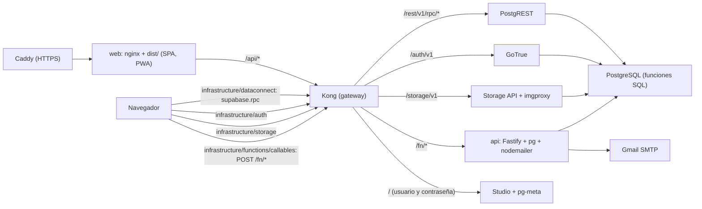
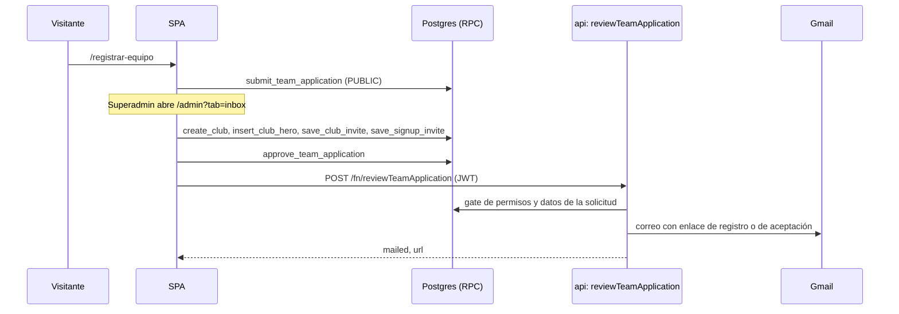

# Clubs Platform

Aplicación web para organizar una liga de fútbol amateur: clubes por localidad, temporadas, categorías, torneos con calendario y tabla, renta de canchas, y un panel por club para agenda, jugadores, finanzas e inventario.

[](https://react.dev/)
[](https://www.typescriptlang.org/)
[](https://vitejs.dev/)
[](https://www.postgresql.org/)
[](https://www.docker.com/)

Todo el sistema se **autoaloja con Docker**: Postgres, autenticación, imágenes, API de correo y frontend salen de un solo `docker compose up`. No depende de ningún servicio de Google ni de Firebase.

---

## Contenido

- [Overview](#overview)
- [Features](#features)
- [Architecture](#architecture)
- [Tech Stack](#tech-stack)
- [Requirements](#requirements)
- [Installation](#installation)
- [Configuration](#configuration)
- [Usage](#usage)
- [Development](#development)
- [Project Structure](#project-structure)
- [How It Works](#how-it-works)
- [API](#api)
- [Database](#database)
- [Authentication & Authorization](#authentication--authorization)
- [Testing, Linting & Type checking](#testing-linting--type-checking)
- [Build & Production](#build--production)
- [Deployment](#deployment)
- [Scripts](#scripts)
- [Troubleshooting](#troubleshooting)
- [Known Limitations](#known-limitations)
- [Contributing](#contributing)
- [License](#license)

---

## Overview

Clubs Platform es una SPA en React sobre un backend autoalojado (recorte del stack de Supabase):

- **PostgreSQL** guarda todos los datos. El navegador no toca tablas: llama a **funciones SQL** (una por operación) a través de PostgREST.
- **GoTrue** (Supabase Auth) identifica a cada persona con correo y contraseña.
- **Supabase Storage** guarda las imágenes en el bucket público `media`; SQL guarda sus URLs.
- **API propia** (`api/`, Node + Fastify) envía los correos de invitaciones y avisos.
- **Kong** es el gateway (`/auth/v1`, `/rest/v1`, `/storage/v1`, `/fn`) y protege **Studio**, el panel de administración de la base.

Hay tres tipos de usuario:

- **Visitantes** (sin sesión): ven la portada, torneos, tablas, goleadores, calendario, directorio de equipos, partidos próximos, canchas en renta y la página pública de cada club (`/:slug`). Pueden mandar un mensaje de contacto o solicitar el registro de un equipo.
- **Miembros de un club** con rol `admin` (Presidente), `dt` (D. Técnico), `tesorero` o `prensa`: editan las secciones de su club que su rol permite.
- **Superadministradores de la plataforma** (tabla `platform_admins`): gestionan clubes, localidades, temporadas, categorías, torneos, partidos, canchas, anuncios, portada, bandeja de solicitudes y otros superadministradores desde `/admin`.

---

## Features

### Público

| Ruta | Qué ofrece |
|---|---|
| `/` | Portada con diseño «Carbón y Oro»: héroe con carrusel, temporada vigente, botones (inscribirse, registrar equipo, rentar cancha) y cifras reales de la vista `platform_stats` (clubes activos, jugadores y canchas si la renta está activa); sección «En vivo» con el marcador y el minuto de los partidos de hoy; próximos partidos de 6 en 6 (en escritorio rotan cada 6 s; el superadmin los programa desde la tarjeta); torneos con pestañas «En curso / Próximos», fecha de inicio, equipos inscritos y premio al campeón; y al final una franja negra con los anuncios de `home` a todo el ancho (rotan cada 5 s). Si nadie ha reclamado la plataforma, ofrece reclamar la administración. |
| `/torneos` | Archivo de torneos: en curso, próximos y finalizados, con el premio al campeón si tiene. El superadmin puede borrar un torneo que no tenga partidos jugados. |
| `/torneos/:id` | Ficha del torneo: anuncio `tournament`, cabecera (temporada · categoría · modalidad, estado y premio), podio con escudos cuando está finalizado, tabla de posiciones, top 5 de goleadores y calendario por jornada. Cada partido usa la tarjeta de la portada; toda la tarjeta lleva a `/partido/:id` y el superadmin tiene «Programar» y «Marcador». |
| `/temporadas/:id/resumen` | Resumen de una temporada **cerrada** (`season_summary`): podio de cada torneo, cifras (partidos, goles, promedio, tarjetas, penales, walkovers), premios individuales (goleador, asistidor, más MVP y arquero menos goleado con mínimo 3 partidos) y récords (mayor goleada, partido con más goles, mejor ataque, valla menos vencida con mínimo 3 partidos, juego limpio y más tarjetas; amarilla = 1, roja = 3). Solo se enlaza desde «Resumen» en `/admin` → Competencia, pero es pública: la ve quien tenga el enlace, y trae «Compartir». Si la temporada sigue activa o no existe, avisa que no está disponible. Los walkovers no suman goles ni cuentan para los récords de partido ni de arqueros. |
| `/jugadores/:id` | **Ficha pública del jugador** (`player_profile`): foto, edad (nunca la fecha de nacimiento), clubes donde juega o jugó (con «De baja» y «Antes en»), totales y su trayectoria por temporada → torneo → club: partidos, goles (y de penal), asistencias, autogoles, MVP, amarillas y rojas. Se abre desde «Ver ficha completa» en el modal del jugador de la plantilla, el nombre en los goleadores del torneo y los premios del resumen de temporada; trae «Compartir». Un **partido jugado** es un partido oficial con marcador, que no sea walkover, donde aparece por ese club como convocado, en la alineación, con gol, asistencia, tarjeta o MVP; los amistosos del club no cuentan. MVP: solo el que eligió el club. El autogol se cuenta en su club (no en el acreditado). |
| `/equipos` | Anuncio `teams`, directorio de clubes y posiciones por temporada y categoría. |
| `/partidos` | Próximos partidos con filtros por torneo y equipo. La sede se arma con la cancha enlazada («Col. Centro · Futbol 1»). El superadmin los programa o reprograma desde la tarjeta. |
| `/partido/:id` | Página del partido: marcador, minuto y estado, cronología de goles y tarjetas, estadísticas, alineaciones con la formación de cada club y previa (tabla, últimos partidos, historial y convocados). El superadmin ve «Marcador en vivo». |
| `/canchas` | Elegir cancha, fecha, horario y duración según la apertura y los apartados. El botón final abre WhatsApp; elegir un horario **no** reserva nada. Solo aparece si `courts_enabled` está activo. |
| `/contacto` | Formulario de contacto (se guarda en `inquiries`). |
| `/registrar-equipo` | Solicitud de alta de un equipo (se guarda en `team_applications` como pendiente). |
| `/:slug` | Página del club con pestañas `inicio`, `agenda`, `jugadores`, `finanzas`, `inventario` y `administradores` (`?seccion=`). Finanzas, inventario y miembros solo se envían a quien tiene rol en el club o es superadmin. |
| `/terminos`, `/aviso-de-privacidad` | Textos legales. |

### Cuentas

| Ruta | Qué ofrece |
|---|---|
| `/login` | Entrar con correo y contraseña. Acepta `?next=/ruta`. Incluye «olvidé mi contraseña», que pide a GoTrue el correo de recuperación. |
| `/registro` | Crear cuenta. Solo si el correo tiene una invitación (`signup_invites`, `club_invites` o `platform_admin_invites`) o si la plataforma aún no tiene administrador; lo exige un trigger de `auth.users`. Acepta `?email=` y `?next=`. |
| `/restablecer` | Fijar una contraseña nueva. El enlace del correo trae un `token_hash` que se verifica al guardar (abrirlo, recargarlo o que un antivirus lo abra antes no lo gasta); funciona en cualquier navegador. |
| `/invitar` | Aceptar o rechazar una invitación a un club (`?c=&e=&t=`, y `&accion=rechazar`). Aceptar pide sesión con el mismo correo; sin sesión manda a `/login?next=`. |

**Selector de espacios.** Con sesión, la cabecera muestra un selector al estilo de las cuentas de Instagram: la liga (`/`), el panel de administración (`/admin`, solo superadmin) y cada club donde el usuario tiene rol. En escritorio se abre como menú y en móvil como hoja inferior; también incluye «Cerrar sesión».

### Club (`/:slug`), según rol

- **Inicio:** cumpleaños, portada (imágenes del héroe), récord del equipo, vitrina de trofeos, salón de la fama y galería por álbumes. Editar portada y galería requiere `canEditPortada`.
- **Agenda:** entrenamientos, amistosos y partidos oficiales; asistencia, alineación, marcador, álbum y estadísticas del evento. Desde aquí se guarda la **disponibilidad semanal** del club, que se usa para sugerir fechas de partido.
- **Jugadores:** plantilla, estadísticas, comparación y ficha con foto. Un jugador es una persona independiente del club y puede estar en varias plantillas: «¿Ya juega en otro club?» lo busca por nombre en toda la liga (foto, edad y clubes actuales) y lo suma con el dorsal, posición y variante de este equipo; su nombre, foto y nacimiento se comparten (los edita Presidente o DT de cualquiera de sus clubes) y sus estadísticas van por club. Si ya juega ese mismo torneo con otro club, el buscador lo marca y al ficharlo, reactivarlo o inscribir el club en el torneo aparece un **aviso** («ya juega el Apertura con A»), pero nada se bloquea: la liga decide, y si anota con los dos equipos cuenta para cada club. «Baja temporal» lo deja fuera de las listas para pasar asistencia; **eliminar** lo saca de la plantilla y de los selectores de este club, pero conserva su historial y sigue en sus otros clubes; si vuelve, el buscador lo marca «Estuvo en este club» y agregarlo lo restaura (ver Database). «Ver ficha completa» abre su ficha pública en `/jugadores/:id`.
- **Finanzas:** resumen, movimientos (ingresos y gastos), metas con aportación por jugador. El Presidente y el Tesorero ven además la **cuenta con la liga** (`club_league_account`): lo que la liga le cobra al club, lo pagado y el saldo, solo lectura. La tarjeta se titula «Cuenta con <nombre de la página>» (el del Header), muestra los 3 cobros más recientes con «Ver todos» para el resto y se filtra por año y mes del cobro.
- **Inventario:** material por estado (`BUENO`, `MALO`, `PERDIDO`).
- **Miembros:** modal en el encabezado del club para invitar, cambiar roles y cancelar invitaciones (solo Presidente o superadmin).

### Superadministración (`/admin?tab=`)

`clubs`, `players` (jugadores de toda la liga, ver abajo), `competition` (temporadas, categorías, torneos), `cover` (portada y marca de la plataforma), `ads` (anuncios por ubicación `home`, `tournament`, `club`, `teams`; la vigencia la deciden las fechas y «Pausar» es el único freno manual), `inbox` (contactos y solicitudes de equipo), `admins` (superadministradores e invitaciones), `courts` (canchas, horario de apertura, bloque de 30 o 60 minutos, apartados manuales y de partido; la renta se cobra a quien aparta y al apartar se anota si pagó todo o un anticipo: lo que resta se cobra desde el apartado, que lo marca con $ en la rejilla, o en Finanzas) y `finances` (finanzas de la liga, ver abajo).

**Jugadores** (`/admin?tab=players`, `&jugador=<id>` abre uno; funciones `admin_*_player*` de [`1013_fn_admin.sql`](db/migrations/1013_fn_admin.sql)):

- **Buscar** a cualquier jugador por nombre sin acentos (`admin_search_players`, hasta 30); sin texto muestra los creados más recientemente y «Sin club» deja solo a los libres.
- **Nuevo jugador** (`admin_save_player`): nombre, nacimiento y foto (`platform/players/`), con las mismas reglas que la plantilla. El club es **opcional**: con club entra a su plantilla con dorsal, posición y variante; sin club queda **libre** y cualquier club lo suma con «¿Ya juega en otro club?». Mientras se escribe el nombre avisa si ya hay alguien parecido.
- **Ficha con acciones:** la misma ficha pública más «Editar datos» (nombre, nacimiento y foto: se ven en todos sus clubes) y sus **fichas por club**: editar dorsal, posición, variante y activo, quitarlo de una plantilla (borrado lógico) o restaurarlo, y sumarlo a otro club. Usa `save_player`, `delete_player` y `add_existing_player` (el superadmin tiene rol en todos los clubes); el aviso de torneo compartido sale igual que en la plantilla.
- **Unir duplicado** (`admin_merge_players`): cuando dos clubes cargaron a la misma persona por separado. Se busca la otra ficha, se comparan lado a lado y se elige cuál se conserva; todo lo del otro pasa a ella y la otra se borra. **No se puede deshacer**: se confirma escribiendo el nombre. Ver Database.

**Finanzas de la liga** (`/admin?tab=finances`, [`1015_fn_finance.sql`](db/migrations/1015_fn_finance.sql)):

- **Todo se registra solo.** Triggers sobre `matches`, `match_cards`, `tournament_clubs`, `court_holds` y `ads` crean el cobro cuando pasa el hecho: alta de un club en la plataforma (**registro del club**, un solo pago por club, con la tarifa de la temporada de su alta), inscripción de un club a un torneo, partido jugado (arbitraje y **uso de cancha**), tarjeta en un partido jugado, «no se presentó», **renta de cancha** y anuncio con precio. Si el hecho desaparece (baja del torneo, tarjeta borrada, renta cancelada, no presentado deshecho), el cobro se anula; al eliminar una renta con algo pagado se decide si se le devolvió (se anula) o la liga se lo queda (el cobro queda por lo pagado, como historial). No hay cobros que se generen con botón.
- **Tarifas** por temporada (`league_fees`): el precio de cada cobro se pone una sola vez. Arbitraje (a cada club o a medias), no presentarse, amarilla, roja, inscripción al torneo y registro del club. El **uso de cancha** cuesta lo que la cancha del partido por hora × la duración del partido (a medias por defecto), la **renta** usa el costo por hora de la cancha y la **publicidad** el precio del anuncio: esos tres se cobran solos y la tarifa solo sirve para apagarlos. Al guardar una tarifa se registran también los cobros de lo que ya pasó en la temporada (`league_backfill_season`, sin duplicar); `1015` hace lo mismo cada vez que se aplica.
- **Pagado o no.** Cada cobro se marca como pagado o no pagado (`set_league_charge_paid`): pagado abona el saldo con fecha de hoy; no pagado borra sus abonos. Una **renta se paga al apartarse**, completa o con un anticipo (`court_holds.deposit`; abono automático `auto-hold:<id>`); en una renta, pagado o no pagado cobra o quita solo el resto. Si la liga quita la renta (cambio de horario o se borra la cancha), el cobro y lo pagado se anulan. También se puede condonar (cuenta como pérdida), cancelar un error y registrar «Otro cobro» manual a un club o a un externo.
- **Gastos y pérdidas** (`league_expenses`): árbitros, premios, mantenimiento, servicios, material, servidor, publicidad propia y otros; pérdidas = devoluciones (fianza, protesta procedente, reserva pagada y cancelada) y daños y robos, más lo condonado.
- **Resumen** (`admin_finance_summary`) por total, año, mes, temporada o torneo: generado, cobrado, por cobrar, gastos, pérdidas y resultado (cobrado − gastos − devoluciones − daños), desglose por concepto y por categoría, serie mes a mes, año a año o por jornada, **cada registro del periodo** con su botón de pagado, y clubes con adeudo. Lo cobrado cuenta por la fecha del pago; lo generado y lo pendiente, por la fecha del cobro. Rentas y anuncios no pertenecen a un torneo. Los adeudos solo se avisan (también en la lista de clubes); no bloquean nada.

En la ficha del torneo el superadministrador además edita el torneo, suma equipos (genera los partidos, uno o ida y vuelta según `legs`), programa fecha, hora y cancha, y captura marcador, goles y tarjetas.

**Cerrar un torneo** (`close_tournament`) lo deja `FINISHED`, arma el podio con la tabla y desprograma los partidos pendientes liberando sus canchas; un torneo finalizado no admite marcadores, calendario ni inscripciones hasta **reabrirlo** (`reopen_tournament`, solo mientras su temporada siga activa). Cambiar la duración del partido desprograma todos los partidos programados; adelantar la fecha de inicio, solo los anteriores a ella; ningún partido se programa antes del inicio del torneo. Un partido otorgado por ingreso tardío (W.O.) se devuelve a «por programar» con `reset_walkover_match` desde el botón «Marcador». En la misma hoja de «Marcador», un partido con fecha de hoy o anterior se marca como **no jugado** (`mark_match_no_show`): «No se presentó» el local, el visitante o ninguno. Queda como W.O. 3-0 a favor del que llegó, o 0-0 con derrota y 0 puntos para los dos (`matches.no_show`); se borran goles y tarjetas y la ficha dice quién faltó. «Deshacer» (`clear_match_no_show`) lo devuelve a programado con su fecha, hora y cancha. **Cerrar una temporada** (`set_season_active`) exige que sus torneos estén finalizados o forzar el cierre (los finaliza uno a uno); una temporada cerrada no se reabre y muestra el botón «Resumen», que lleva a `/temporadas/:id/resumen`.

### Correo

La API (`api/`) envía correos HTML y texto para: invitación a un club, invitación a superadministrador, aviso de renta de cancha (alta, cambio, cancelación), equipo aprobado, equipo rechazado, inscripción a torneo y programación o cambio de partido. Plantillas en [`api/src/mail.ts`](api/src/mail.ts). El de restablecer contraseña lo manda GoTrue con la plantilla [`api/templates/recovery.html`](api/templates/recovery.html).

### PWA

`vite-plugin-pwa` genera el manifiesto y el service worker con `registerType: "autoUpdate"`. Nombre, nombre corto y descripción salen de [`src/domains/clubs/clubDefaults.ts`](src/domains/clubs/clubDefaults.ts); el ícono es `public/icon.svg`. El registro vive en [`src/app/pwa.ts`](src/app/pwa.ts): cuando se activa una versión nueva tras un despliegue, la pestaña se recarga sola (como máximo una vez por minuto). Para que eso funcione, nginx sirve `index.html`, `sw.js` y el manifiesto con `Cache-Control: no-cache` y solo `assets/*` (con hash) se cachea un año ([`docker/web/default.conf.template`](docker/web/default.conf.template)).

---

## Architecture



- **Cliente.** Solo `src/infrastructure/` importa `@supabase/supabase-js`. [`supabase.ts`](src/infrastructure/supabase.ts) crea el cliente; [`dataconnect.ts`](src/infrastructure/dataconnect.ts) expone una función por operación con la misma firma que tenía el SDK de Data Connect (`op(dataConnect, variables, opciones)` → `{ data }`), que llama a `supabase.rpc("<nombre_en_snake>", { p: variables })`; los tipos de resultado están en [`api/types.ts`](src/infrastructure/api/types.ts). [`auth.ts`](src/infrastructure/auth.ts), [`storage/uploadImage.ts`](src/infrastructure/storage/uploadImage.ts) y [`functions/callables.ts`](src/infrastructure/functions/callables.ts) envuelven sesión, imágenes y la API.
- **Base de datos** ([`db/`](db/)). `migrations/0*.sql` crean esquema, vistas, helpers de sesión, triggers de `auth.users` y el bucket; `migrations/1*.sql` definen las **funciones RPC** (`SECURITY DEFINER`, un argumento `p jsonb`, devuelven `jsonb` con la forma exacta de cada `<Op>Data`). `anon` y `authenticated` no tienen acceso a ninguna tabla: solo pueden ejecutar las funciones que `api_expose()` les concede. `seed/` crea los usuarios de prueba.
- **API** ([`api/`](api/)). Fastify en Node 20: verifica el JWT de GoTrue, lee de Postgres con `pg` y envía correo con `nodemailer`. Kong la expone en `/fn/`.
- **Docker** ([`docker/`](docker/)). `docker-compose.yml` levanta `db`, `kong`, `auth`, `rest`, `storage`, `imgproxy`, `meta`, `studio`, `migrate` (aplica `db/` y termina), `api` y, bajo el perfil `web`, el frontend. `docker-compose.prod.yml` añade Caddy con HTTPS y cierra los puertos internos.

### Capas de `src/`

`app` → `features` → `domains` → `infrastructure` → `shared`. Cada capa importa solo de las que están a su derecha.

- `features/<pantalla>/`: `use<Pantalla>.ts` ejecuta la query, `<pantalla>Mapper.ts` arma solo lo que se pinta, `<pantalla>ViewState.ts` tipa la vista y `<Pantalla>View.tsx` la dibuja.
- `domains/<dominio>/`: reglas y comandos (`*Commands.ts`) que llaman las mutaciones. Si una mutación devuelve `null` en su clave, el guardado falló (`savedRow()`).

---

## Tech Stack

| Área | Tecnología |
|---|---|
| Lenguaje | TypeScript (frontend `typescript` 7; API `typescript` 5) |
| UI | React 18.3, React Router DOM 7, `lucide-react`, CSS global (`src/index.css`) |
| Build | Vite 5, `@vitejs/plugin-react`, `vite-plugin-pwa` |
| Imágenes | `browser-image-compression` antes de subir a Storage |
| SDK cliente | `@supabase/supabase-js` 2 (Auth, RPC, Storage) |
| Base de datos | PostgreSQL 17 (imagen `supabase/postgres`) + PostgREST |
| Identidad | GoTrue (`supabase/gotrue`) |
| Imágenes (servidor) | `supabase/storage-api` + `imgproxy`, backend en disco |
| Gateway | Kong 2.8 |
| API de correo | Node 20, Fastify 5, `pg`, `nodemailer`, `jose` |
| Frontend en producción | nginx 1.27 (imagen multi-stage) |
| HTTPS | Caddy 2 (solo producción) |
| Verificación SQL | `@electric-sql/pglite` (Postgres embebido, sin Docker) |
| CI | GitHub Actions (`.github/workflows/ci.yml`) |

---

## Requirements

- **Docker** con Docker Compose v2 (Docker Desktop en Windows/macOS, o `docker` + plugin compose en Linux). Unos 3 GB de RAM libres para el stack.
- **Node.js 20** y **npm** para el frontend, los scripts y la API.
- Opcional: una cuenta de Gmail con contraseña de aplicación para enviar correo (invitaciones, avisos y restablecer contraseña).

---

## Installation

```bash
git clone https://github.com/CarlosQuinto/clubs-platform.git
cd clubs-platform

npm install
(cd api && npm install)     # no uses `npm --prefix api install`: un bug de npm añade una dependencia falsa

npm run docker:env        # crea docker/.env con secretos nuevos e imprime las VITE_*
cp .env.example .env      # pega ahí las tres líneas VITE_* que imprimió docker:env

npm run demo:sql          # datos dummy (opcional pero recomendable)
npm run docker:up         # levanta el stack; «migrate» aplica esquema, funciones y semilla

npm run dev
```

Vite sirve la app en `http://localhost:5173` contra el gateway en `http://localhost:8000`. Studio queda en `http://localhost:8000` con el usuario y la contraseña de `DASHBOARD_*` (`docker/.env`). La API responde en `http://localhost:8787/health` y en `http://localhost:8000/fn/`.

Usuarios de prueba (contraseña `demo1234`, ver [`db/seed/00_usuarios.sql`](db/seed/00_usuarios.sql)): `admin@demo.local` (superadmin), `presidente@demo.local`, `dt@demo.local`, `tesorero@demo.local`, `prensa@demo.local` (Halcones FC) y `presidente2@demo.local` (Deportivo Bahía).

---

## Configuration

### Aplicación web (`.env` en la raíz)

Se leen con `import.meta.env` en [`src/infrastructure/env.ts`](src/infrastructure/env.ts) y se fijan al compilar.

| Variable | Obligatoria | Descripción | Ejemplo |
|---|---|---|---|
| `VITE_SUPABASE_URL` | Sí | URL pública del gateway (Kong) | `http://localhost:8000`, `https://liga.ejemplo.com/api` |
| `VITE_SUPABASE_ANON_KEY` | Sí | Clave `anon` (JWT firmado con `JWT_SECRET`; la genera `docker:env`) | `eyJ...` |
| `VITE_API_URL` | No | Base de la API de correo; por defecto `${VITE_SUPABASE_URL}/fn` | `http://localhost:8787/fn` |

Si falta alguna, la consola avisa y la app intenta arrancar igual.

### Stack Docker (`docker/.env`)

Plantilla en [`docker/.env.example`](docker/.env.example); `npm run docker:env` la copia a `docker/.env` rellenando los secretos (`POSTGRES_PASSWORD`, `JWT_SECRET`, `ANON_KEY`, `SERVICE_ROLE_KEY`, `DASHBOARD_PASSWORD`, `PG_META_CRYPTO_KEY`). Las demás:

| Variable | Descripción |
|---|---|
| `SUPABASE_PUBLIC_URL`, `API_EXTERNAL_URL` | URL pública del gateway y de GoTrue (`.../auth/v1`). En producción con un solo dominio: `https://DOMINIO/api` y `https://DOMINIO/api/auth/v1`. |
| `SITE_URL`, `ADDITIONAL_REDIRECT_URLS` | URL del frontend (enlaces de los correos) y destinos permitidos al volver de un enlace de GoTrue (`https://DOMINIO/**`). |
| `SMTP_*` | Servidor de correo de GoTrue (restablecer contraseña). Con Gmail: `smtp.gmail.com`, `465`, la cuenta y una contraseña de aplicación. |
| `GMAIL_USER`, `GMAIL_APP_PASSWORD` | Remitente de la API (invitaciones y avisos). Sin ellos la API guarda los datos y responde `mailed: false`. |
| `DB_SEED` | `true` carga `db/seed` y `scripts/demo/demo-seed.sql` al migrar. Ponlo en `false` en producción. |
| `KONG_HTTP_PORT`, `POSTGRES_HOST_PORT`, `API_HOST_PORT`, `WEB_HOST_PORT` | Puertos expuestos en desarrollo (8000, 5432, 8787, 8080). |
| `CORS_ORIGINS`, `TRUST_PROXY` | Orígenes permitidos en la API y si lee la IP real de `X-Forwarded-For`. |
| `DOMAIN` | Solo producción: dominio para Caddy. |

### Constantes de marca

[`src/domains/clubs/clubDefaults.ts`](src/domains/clubs/clubDefaults.ts) define `PLATFORM_NAME`, `PLATFORM_SHORT_NAME`, `PLATFORM_DESCRIPTION`, las imágenes de portada por defecto y los valores iniciales de un club. `vite.config.ts` las usa para el manifiesto PWA. El nombre, lema, logo y redes que se ven en la app se editan en `/admin?tab=cover` y se guardan en `platform_settings`.

---

## Usage

Primer arranque con la base vacía (`DB_SEED=false`):

1. Abre `/registro` y crea la primera cuenta. Mientras `platform_admins` está vacía el trigger de `auth.users` deja registrarse sin invitación y convierte a esa cuenta en superadministrador. La portada también ofrece reclamar la administración mientras nadie lo haya hecho.
2. En `/admin?tab=competition` crea temporadas (solo números y guion, hasta 11 caracteres), categorías y torneos. El **premio al campeón** es opcional.
3. En `/admin?tab=clubs` crea clubes (nombre, URL y localidad son obligatorios) o aprueba solicitudes en `/admin?tab=inbox`. Al aprobar se crea el club y se invita por correo al capitán como Presidente.
4. En la ficha del torneo suma equipos para generar los partidos, programa fecha, hora y cancha, y captura marcadores.
5. Opcional: en `/admin?tab=courts` da de alta canchas y el horario de apertura, y activa el módulo público de canchas.
6. Cada Presidente invita a su cuerpo técnico desde **Miembros** en la página de su club.

---

## Development

```bash
npm run dev             # Vite con recarga en caliente, contra el stack Docker
npm run db:migrate      # vuelve a aplicar db/migrations y la semilla (p. ej. tras editar una función SQL)
npm run db:reset        # borra los volúmenes, regenera los datos dummy y arranca de cero
npm run db:check        # sin Docker: Postgres embebido aplica migraciones y semilla y corre scripts/db/pruebas/*.mjs
npm run docker:logs     # logs de todos los servicios
npm run docker:down     # apaga el stack (los datos quedan en los volúmenes)
npx tsc --noEmit        # tipos del frontend
npm run api:build       # compila la API
npm run check:firebase  # falla si reaparece Firebase
```

### Cambiar el esquema o una operación

- **Esquema:** añade una migración nueva con el siguiente número libre (`db/migrations/0012_*.sql` después de `0011`; las `0*` se aplican una sola vez y quedan anotadas en `public.schema_migrations`). No edites `0001_schema.sql` en una base que ya existe.
- **Operaciones:** cada operación del cliente es una función `public.<nombre_en_snake>(p jsonb) RETURNS jsonb` en `db/migrations/1*.sql` (se vuelven a aplicar en cada `db:migrate` porque usan `CREATE OR REPLACE`). Su salida debe tener exactamente la forma de la interfaz `<Op>Data` de [`src/infrastructure/api/types.ts`](src/infrastructure/api/types.ts). Al crear una, añade su export en [`src/infrastructure/dataconnect.ts`](src/infrastructure/dataconnect.ts) y sus tipos, y una prueba en `scripts/db/pruebas/`.

Reglas de las funciones SQL (detalladas en la cabecera de [`db/migrations/1010_fn_public.sql`](db/migrations/1010_fn_public.sql)):

- `SECURITY DEFINER SET search_path = public, pg_temp`; `LANGUAGE sql STABLE` para lecturas y `plpgsql` para escrituras (una función = una transacción). Al final, `CALL api_expose('<nombre>', 'PUBLIC' | 'USER')`.
- Permisos siempre con la sesión del servidor: `require_uid()`, `is_platform_admin()`, `has_club_role(club_id, ARRAY['ADMIN','DT'])`, `session_email()`. Nunca con un `userId` enviado por el cliente.
- Las escrituras devuelven una clave por paso; `null` significa permiso denegado o validación fallida.
- Listas con `coalesce(jsonb_agg(... ORDER BY ...), '[]')`, relaciones opcionales con `CASE WHEN ... IS NULL THEN NULL ELSE jsonb_build_object(...) END`, `_count` como `[{ "_count": n }]`, enums y fechas con `to_jsonb()`, timestamps con `api_ts()`.
- Las validaciones de texto (`char_length(btrim(...)) BETWEEN`, regex `~`) deben ser idénticas a las de [`src/shared/textLimits.ts`](src/shared/textLimits.ts).

---

## Project Structure

```text
clubs-platform/
├── .github/workflows/ci.yml       # tipos, build, check:firebase, db:check, api y las dos imágenes Docker
├── api/                           # API de correo e invitaciones (Fastify + pg + nodemailer)
│   ├── Dockerfile
│   ├── src/                       # server.ts, auth.ts (JWT), db.ts (SQL), mail.ts (plantillas), fns/*.ts
│   └── templates/recovery.html    # correo de restablecer contraseña (lo envía GoTrue)
├── db/
│   ├── migrate.sh                 # lo ejecuta el servicio «migrate» del compose
│   ├── migrations/
│   │   ├── 0001_schema.sql        # 48 tablas y 17 enums
│   │   ├── 0002_views.sql         # 7 vistas calculadas
│   │   ├── 0003_auth.sql          # helpers de sesión, triggers de auth.users, rol api_service
│   │   ├── 0004_storage.sql       # bucket «media» y sus políticas
│   │   ├── 1010_fn_public.sql     # funciones RPC: pantallas públicas y sesión
│   │   ├── 1011_fn_club.sql       # funciones RPC: panel del club
│   │   ├── 1012_fn_league.sql     # funciones RPC: competición y marcador en vivo
│   │   ├── 0006_no_presentado.sql # matches.no_show y la tabla con «no se presentó ninguno»
│   │   ├── 0007_finanzas_liga.sql # tarifas, cargos, pagos y gastos de la liga
│   │   ├── 0008_jugadores_borrado_logico.sql # players.deleted_at (borrado lógico de jugadores)
│   │   ├── 0009_rentas_anticipo.sql # court_holds.deposit (anticipo); se quita court_holds.club_id
│   │   ├── 0010_jugadores_multiclub.sql # club_players: un jugador en varios clubes; players queda como persona
│   │   ├── 0011_jugadores_indices.sql # índices por jugador para su ficha y para unir duplicados
│   │   ├── 1013_fn_admin.sql      # funciones RPC: /admin
│   │   ├── 1014_fn_api.sql        # funciones de la API de correo
│   │   └── 1015_fn_finance.sql    # finanzas de la liga: triggers de cargos, resumen y RPC
│   └── seed/                      # usuarios de prueba y sus roles en los clubes dummy
├── docker/
│   ├── docker-compose.yml         # stack de desarrollo y base de producción
│   ├── docker-compose.prod.yml    # Caddy + HTTPS, puertos cerrados
│   ├── Caddyfile
│   ├── .env.example               # plantilla de docker/.env (npm run docker:env)
│   ├── volumes/api/kong.yml       # rutas del gateway
│   ├── volumes/db/                # init de roles y jwt de la imagen de Postgres
│   └── web/                       # Dockerfile del frontend y plantilla de nginx
├── postman/                       # colección y entornos de Postman (npm run postman:collection)
├── public/icon.svg
├── scripts/
│   ├── api/                       # generadores usados en la migración (tipos y shim)
│   ├── checkFirebase.mjs          # guarda de CI
│   ├── db/check.mjs               # verificación con Postgres embebido
│   ├── db/pruebas/*.mjs           # pruebas de las funciones SQL por bloque
│   ├── demo/generarDemo.mjs       # datos dummy
│   ├── docker/generarEnv.mjs      # secretos y claves del stack
│   └── postman/generarColeccion.mjs # colección de Postman a partir de las funciones y tipos
├── src/
│   ├── main.tsx
│   ├── app/                       # rutas (App.tsx), PWA y marca del documento
│   ├── features/                  # una carpeta por pantalla
│   ├── domains/                   # reglas y comandos por dominio
│   ├── infrastructure/            # env, supabase, api/{rpc,types}, dataconnect (shim), auth, storage, functions/callables
│   └── shared/                    # ui, tipos, rutas, límites de texto, utilidades
├── .env.example
├── vite.config.ts
└── package.json
```

---

## How It Works

### Sesión y rol de superadministrador

1. `AuthProvider` ([`src/domains/auth/AuthContext.tsx`](src/domains/auth/AuthContext.tsx)) escucha la sesión de GoTrue (`watchSession`).
2. Con sesión, consulta `platformAdminById`. `isSuperAdmin` es verdadero solo si hay fila en `platform_admins`; mientras la consulta no responde, `/admin` espera.
3. Al entrar o registrarse ejecuta `ensureMyProfile` (nombre en `users`) y `claimPlatformAdminInvite`, que convierte en superadmin a quien tenga una invitación en `platform_admin_invites` para el correo de su sesión.
4. Después del login, [`destinations.ts`](src/domains/auth/destinations.ts) acepta las invitaciones de club abiertas para ese correo (`myOpenClubInvites` + `acceptClubInvite`) y decide a dónde llevar al usuario.
5. El selector de espacios lee los clubes con `mySpaces`, que filtra por `auth.uid()` en el servidor.

### Registro, perfil y primer administrador

Dos triggers sobre `auth.users` ([`db/migrations/0003_auth.sql`](db/migrations/0003_auth.sql)):

- **Antes de insertar:** rechaza el registro si el correo no tiene invitación en `signup_invites`, `club_invites` ni `platform_admin_invites`, salvo que `platform_admins` esté vacía. GoTrue responde «Database error saving new user» y la app lo traduce a «Necesitas una invitación para registrarte».
- **Después de insertar:** crea la fila de `public.users` (id = uuid de la cuenta como texto, nombre de `display_name`) y, si no hay superadministrador, inserta al nuevo usuario en `platform_admins`.

### Invitaciones

Todo vive en SQL: `club_invites`, `platform_admin_invites` y `signup_invites`.

- **Club.** El Presidente invita desde Miembros: `saveClubInvite` guarda la invitación con un token y `sendClubInvite` (API) manda el correo. Si el correo ya tiene cuenta, el enlace va a `/invitar`; si no, a `/registro`. `/invitar` lee la invitación con `clubInviteLookup`, acepta con `acceptClubInvite` (exige que la sesión sea del correo invitado) y rechaza con `declineClubInvite` (basta el token).
- **Superadmin.** `savePlatformAdminInvite` + `saveSignupInvite` y el correo de `sendPlatformAdminInvite`. Se reclama al entrar con ese correo. `removePlatformAdminInvite` la cancela.

### Solicitud de equipo hasta su club



Al rechazar, la app ejecuta `rejectTeamApplication` y la API manda el correo de rechazo.

### Programar un partido y la tabla

- La ficha del torneo, la portada y `/partidos` usan el mismo formulario (`features/matches/MatchScheduleForm.tsx`). Ofrece las canchas con `football` y `active` verdaderos, libres en la apertura y sin un apartado que se cruce. Las tres fechas sugeridas salen de la disponibilidad de ambos clubes, la apertura y los partidos que ya tienen.
- Al guardar, si la cancha ya no está libre, no se guarda y se muestra «Esa cancha no está disponible en esa fecha y hora».
- Después de programar, la app llama a `sendMatchScheduleNotice`. La API compara fecha, hora y cancha con `matches.schedule_notice_key`; solo si cambiaron, avisa a los Presidentes de ambos clubes y actualiza la llave.
- Al sumar equipos a un torneo, la app llama a `sendTournamentEnrollmentNotice`. La API inserta en `tournament_notices` y solo manda el correo si la fila es nueva.
- La tabla de posiciones y los goleadores no se guardan: son vistas SQL (`tournament_standings`, `tournament_scorers`) sobre los partidos `PLAYED`. Victoria 3, empate 1; desempate por puntos, diferencia, goles a favor e ID de club. Un partido con `no_show = 'BOTH'` cuenta como derrota sin puntos para los dos.

### Partidos en vivo

- La sección «En vivo» de `/` lee los partidos de ayer y hoy con `liveMatches` (pública). Un partido está **en vivo** desde su hora de inicio hasta inicio + `tournaments.duration_minutes` + 3 minutos (`LIVE_MARGIN_MINUTES` en `domains/matches/liveMatchPhase.ts`). La fase se calcula en el navegador.
- **Marcador en vivo.** Desde `/partido/:id`, el superadmin registra cada gol y cada tarjeta al momento, con su minuto (`addLiveMatchGoal`, `deleteLiveMatchGoal`, `addLiveMatchCard`, `deleteLiveMatchCard`). Mientras el partido sigue `SCHEDULED`, cada cambio recalcula `home_score`/`away_score` contando `match_goals`. El id del evento lo genera el navegador (`crypto.randomUUID()`) y el SQL usa `ON CONFLICT (id)`, así que reintentar no lo duplica.
- **Finalizar partido** (`finishLiveMatch`) recalcula el marcador, deja el partido en `PLAYED` y activa el torneo si seguía próximo. Las correcciones posteriores se hacen con «Marcador» en la ficha del torneo.
- **Sondeo.** La portada vuelve a consultar cada 15 s mientras hay un partido en vivo y la pestaña está visible; la página del partido hace lo mismo desde 2 min antes del inicio hasta una hora después del fin (`shared/useVisibleInterval.ts`).
- **Alineaciones.** Son las que guarda cada club en `match_club_reports.lineup` (`{mode, formation, positions}`); las coordenadas están en `domains/matches/formations.ts`.

---

## API

Servidor Fastify en [`api/`](api/), expuesto por Kong en `${VITE_SUPABASE_URL}/fn/` (en desarrollo también `http://localhost:8787`). El cliente lo llama desde [`src/infrastructure/functions/callables.ts`](src/infrastructure/functions/callables.ts) con `POST /fn/<nombre>`, cuerpo JSON y `Authorization: Bearer <token de la sesión>`.

| Endpoint | Auth | Qué hace |
|---|---|---|
| `sendClubInvite` | Sesión + Presidente del club o superadmin | Manda el correo de una invitación ya guardada en SQL. |
| `sendPlatformAdminInvite` | Sesión + superadmin | Manda el correo de invitación a superadministrador (límite por admin y por correo). |
| `reviewTeamApplication` | Sesión + superadmin | Manda el correo de solicitud aprobada o rechazada. |
| `sendMatchScheduleNotice` | Sesión + superadmin | Avisa a ambos clubes que su partido quedó programado o cambió. No repite el aviso si nada cambió. Con `reason: "courts"` y el partido ya sin fecha, avisa que quedó por reprogramar porque cambió el horario de canchas. |
| `sendTournamentEnrollmentNotice` | Sesión + superadmin | Avisa una sola vez a cada club recién inscrito. |
| `sendCourtBookingNotice` | Sesión | Correo de renta de cancha: `created`, `updated` o `cancelled`. |
| `GET /health` | Ninguna | `{ ok: true }` |
| `GET /templates/:nombre` | Ninguna | Plantillas de correo de GoTrue. |

Los errores son `{ code, message }` con los códigos `unauthenticated` (401), `permission-denied` (403), `invalid-argument` (400), `not-found` (404), `failed-precondition` (412) o `resource-exhausted` (429) y mensajes en español; el cliente los relanza como `functions/<code>`. Si Gmail no está configurado, responden `mailed: false` y la operación de datos queda guardada.

Restablecer contraseña no pasa por la API: `requestPasswordReset` llama a `supabase.auth.resetPasswordForEmail` y GoTrue manda el correo con la plantilla `api/templates/recovery.html` (configuración `SMTP_*`). El enlace lleva a `/restablecer?token_hash=…&type=recovery` (`{{ .RedirectTo }}` + `{{ .TokenHash }}`), y la página lo verifica con `verifyOtp` solo al guardar la contraseña nueva, en un cliente que no persiste sesión: así el enlace no se gasta al abrirlo (prefetch del navegador, escáner del correo, recarga) y la app no queda con sesión iniciada. Caduca en una hora (`GOTRUE_MAILER_OTP_EXP`).

### Probar con Postman

[`postman/`](postman/) trae una colección con todas las funciones RPC (una carpeta por archivo `db/migrations/1*.sql`, separadas en lecturas y mutaciones), la sesión de GoTrue, las imágenes de Storage y los endpoints de correo, más dos entornos: local (`http://localhost:8000`) y servidor de pruebas.

1. Importa `clubs-platform.postman_collection.json` y el entorno que vayas a usar, y selecciónalo.
2. Pega la `anon_key` en el entorno (`ANON_KEY` de `docker/.env`; no se guarda en el repo). En el servidor, pon también `email` y `password` de una cuenta real (allí no hay usuarios demo).
3. Ejecuta **0. Sesión → Login**: guarda el token en el entorno y todas las peticiones lo usan (sin token van como `anon`).

Los bodies de ejemplo usan los ids de la base demo (variables de la colección: `club_id`, `match_id`, `tournament_id`…); `{{hoy}}` y `{{ahora}}` se calculan en cada envío. Solo incluyen los campos obligatorios: los opcionales se listan en la descripción de cada petición, porque omitirlos suele significar «conservar el valor». Las mutaciones traen una prueba que falla si todas las claves de la respuesta vuelven en `null` (la función rechazó el cambio).

La colección se genera con `npm run postman:collection`: no la edites a mano; regenérala después de añadir o cambiar una función.

---

## Database

Todo está en PostgreSQL, definido en [`db/migrations/0001_schema.sql`](db/migrations/0001_schema.sql). Los `id` de tipo texto son `varchar(128)` (los nuevos son UUID generados en el navegador); `users.id` es el uuid de la cuenta de GoTrue como texto; las horas `HH:mm` se guardan como `varchar(5)`.

| Dominio | Tablas |
|---|---|
| Plataforma | `users`, `platform_settings`, `platform_admins`, `platform_admin_invites`, `platform_hero_images`, `court_open_windows`, `signup_invites`, `email_outbox`, `request_throttles` |
| Competición | `localities`, `categories`, `seasons`, `tournament_groups`, `tournaments`, `tournament_clubs`, `tournament_podium`, `tournament_notices` |
| Partidos | `matches`, `match_club_reports`, `match_attendees`, `match_goals`, `match_cards`, `match_goalkeepers` |
| Canchas | `courts` (nombre y descripción de 3 a 15, ubicación opcional de 3 a 60), `court_holds`, `court_open_windows` (el horario se guarda entero con `save_court_module`: interruptor, paso de 30 o 60 y franjas HH:MM; si una renta manual pendiente o un partido programado quedan fuera del horario nuevo, devuelve `conflicts` / `matchConflicts` y no guarda; con `force` elimina las rentas (`removed`, aviso de cancelación) y deja los partidos por programar (`unscheduledMatches`, aviso «por reprogramar» a los clubes) |
| Clubes | `clubs`, `club_hero_images`, `club_availability_windows`, `club_default_lineups`, `club_members`, `club_invites`, `players` (la persona: nombre, nacimiento, foto), `club_players` (su pertenencia a cada club: dorsal, posición, variante, cuerpo técnico, activo, baja; [`0010_jugadores_multiclub.sql`](db/migrations/0010_jugadores_multiclub.sql)) |
| Agenda del club | `club_events`, `club_event_attendees`, `club_event_goals`, `club_event_cards`, `club_event_goalkeepers`, `club_event_photos` |
| Finanzas e inventario | `transactions`, `financial_goals`, `goal_contributions`, `inventory_items` |
| Finanzas de la liga | `league_fees`, `league_charges`, `league_payments`, `league_expenses` ([`0007_finanzas_liga.sql`](db/migrations/0007_finanzas_liga.sql)); además `ads.price`, `ads.advertiser_name`, `ads.advertiser_contact` y `court_holds.deposit` ([`0009_rentas_anticipo.sql`](db/migrations/0009_rentas_anticipo.sql)) |
| Galería | `albums`, `gallery_photos` |
| Anuncios y entrada | `ads`, `ad_placements`, `inquiries`, `team_applications` |

**Eliminar un club es un borrado lógico** (`deleteClub`): se borran sus invitaciones pendientes y se marca `clubs.deleted_at` con `active = false`. Sus jugadores, partidos, podios y finanzas se conservan. Para restaurarlo: `UPDATE clubs SET deleted_at = NULL, active = true WHERE slug = '<slug>';` (desde Studio o `psql`).

**Un jugador puede estar en varios clubes** ([`0010_jugadores_multiclub.sql`](db/migrations/0010_jugadores_multiclub.sql)): `players` es la persona y `club_players` una fila por club con lo que es de ese club. `search_players` (ADMIN o DT del club) busca por nombre en toda la liga sin acentos ni mayúsculas, excluye a los que ya están vivos en el club y marca con `inThisClub = 'DELETED'` a los que fueron eliminados ahí; `add_existing_player` lo suma con su dorsal, posición y variante (o lo restaura con su historial) y devuelve `reason: 'ALREADY'` si ya está. `save_player` solo edita a quien está en el club (otro club no lo pisa ni se lo suma) y cambia los datos de la persona para todos sus clubes. **Jugar el mismo torneo con dos clubes solo produce un aviso** (`player_tournament_conflict`): `search_players`, `add_existing_player` y reactivar con `save_player` devuelven `conflict: { clubName, tournamentName }` junto al resultado guardado, y `add_tournament_club` inscribe al club y devuelve `conflicts: [{ playerName, clubName }]` si alguno de sus jugadores activos ya juega ese torneo con otro club. Nada se rechaza por eso; el cuerpo técnico no cuenta. Las estadísticas, premios de temporada y goleadores siguen siendo por jugador **y club** (cada hecho guarda su `club_id`); `platform_stats` cuenta a cada persona una vez.

**Eliminar un jugador también es un borrado lógico** (`delete_player`): se marca `club_players.deleted_at` en ese club y queda con `active = false` (una restricción impide que un eliminado vuelva a estar activo sin restaurarlo); en sus otros clubes no cambia nada. Se conservan sus goles, tarjetas, MVP, asistencias, alineaciones, estadísticas de portero, aportaciones a metas y movimientos; volver a guardar un evento o partido viejo no los borra. Deja de salir en la plantilla (también en «Inactivos»), en los selectores de asistencia, alineación, aportaciones y marcador en vivo, en la alineación base y en la cifra de jugadores de la portada (si ya estaba convocado a un evento, la asistencia lo muestra como «Eliminado», sin contarlo, para poder quitarlo). Sigue saliendo, atenuado y con «Eliminado», en el Salón de la Fama, y en la ficha y la hoja de marcador de los partidos donde aparece. `save_player` y `set_goal_contribution` lo rechazan. Para verlos: `SELECT pl.id, pl.name, cp.deleted_at FROM club_players cp JOIN players pl ON pl.id = cp.player_id WHERE cp.deleted_at IS NOT NULL AND cp.club_id = (SELECT id FROM clubs WHERE slug = '<slug>');`. Para restaurarlo, búscalo en «¿Ya juega en otro club?» de la pestaña Jugadores (sale como «Estuvo en este club») y agrégalo: vuelve con todo su historial. No lo des de alta otra vez, o su historial quedará partido en dos.

**Ficha del jugador** (`player_profile`, pública): devuelve `age` y no `birthDate`, los clubes vivos con `status` `ACTIVE`, `INACTIVE` (de baja) o `FORMER` (eliminado ahí), `totals` y `statLines` (una fila por temporada, torneo y club; `club.slug` es null si el club se borró, pero sus números quedan). Solo cuenta partidos `PLAYED` con marcador y sin walkover; goles y asistencias siguen a `tournament_scorers`; el autogol (`is_own_goal`, cuyo `club_id` es el club acreditado) se cuenta en el club contrario. **Unir duplicados** (`admin_merge_players`, solo superadmin, una transacción): pasa al destino plantillas (si los dos están en el mismo club queda la ficha más viva), convocatorias, goles, asistencias, tarjetas, MVP, alineaciones guardadas en JSON (partidos, eventos y alineación por defecto), asistencia a eventos, porteros, aportes (si los dos aportaron a la misma meta se suman) y movimientos; luego borra el origen. Nombre, nacimiento y foto: gana el destino y lo vacío se completa con el origen; la foto que sobra vuelve como `orphanImageUrl` para borrarla de Storage. El nombre guardado en los goles se actualiza, pero **el de las tarjetas no**: es la clave de las multas (`league_match_expected`) y cambiarlo las cancelaría y crearía de nuevo. No hay deshacer: haz un respaldo antes si tienes dudas.

Desactivar un club (botón del ojo en `/admin`) pone `clubs.active = false` y exige un motivo en `clubs.disabled_reason` (de 5 a 100 caracteres); su página sigue abierta y muestra el motivo con un enlace a `/contacto`.

Enums: `member_role` (`ADMIN`, `DT`, `PRENSA`, `TESORERO`), `tournament_status` (`UPCOMING`, `ACTIVE`, `FINISHED`), `match_status` (`UNSCHEDULED`, `SCHEDULED`, `PLAYED`), `football_type` (`FUT_7`, `FUT_9`, `FUT_11`), `court_hold_source`, `ad_status`, `ad_placement_kind`, `team_application_status`, `invite_kind`, `event_type`, `card_color`, `transaction_type`, `transaction_source`, `goal_status`, `inventory_condition`, `inquiry_status`, `friendly_match_type`, `match_no_show` (`HOME`, `AWAY`, `BOTH`), `league_fee_kind`, `league_charge_status` (`PENDIENTE`, `PARCIAL`, `PAGADO`, `CONDONADO`, `CANCELADO`), `league_payment_method`.

Vistas ([`db/migrations/0002_views.sql`](db/migrations/0002_views.sql)):

| Vista | Contenido |
|---|---|
| `platform_claim_states` | `open = true` si `platform_admins` está vacía |
| `platform_stats` | Cifras de la portada: clubes activos, jugadores activos (sin cuerpo técnico; cada persona una vez aunque esté en varios clubes) y canchas activas |
| `match_listings` | Partidos `SCHEDULED` con fecha y hora, con `starts_at` para ordenar |
| `tournament_standings` | PJ, G, E, P, GF, GC, DG, puntos y posición por torneo |
| `tournament_scorers` | Goles y asistencias por jugador (sin autogoles) |
| `club_ledger` | Movimientos del club más aportaciones a metas |
| `player_contribution_totals` | Total aportado por jugador y club (el club sale de la meta o del movimiento) |

Las imágenes están en el bucket `media` bajo `platform/**` y `clubs/{clubId}/{logos|portada|gallery|players|events}/**`; SQL guarda sus URLs públicas (`${VITE_SUPABASE_URL}/storage/v1/object/public/media/...`).

**Copias de seguridad.** `docker compose --project-directory docker exec db pg_dump -U postgres postgres > respaldo.sql` para la base y el volumen `storage-data` para las imágenes.

---

## Authentication & Authorization

- **Autenticación:** GoTrue con correo y contraseña, sin confirmación de correo. El registro está limitado a correos invitados, salvo el primer usuario.
- **Superadmin:** fila en `platform_admins`. No hay otra fuente.
- **Roles de club** ([`src/domains/auth/roles.ts`](src/domains/auth/roles.ts), `buildPerms`), leídos de `club_members` con `clubScreen`:

| Rol | Portada y galería | Agenda | Jugadores | Finanzas | Inventario | Miembros |
|---|:-:|:-:|:-:|:-:|:-:|:-:|
| Superadmin / `admin` (Presidente) | ✓ | ✓ | ✓ | ✓ | ✓ | ✓ |
| `dt` (D. Técnico) | | ✓ | ✓ | | ✓ | |
| `tesorero` | | | | ✓ | ✓ | |
| `prensa` | ✓ | | | | | |

- **Funciones SQL:** la comprobación real ocurre en el servidor con `auth.uid()`. Las operaciones `PUBLIC` las pueden llamar `anon` y `authenticated`; las `USER` solo `authenticated`. Ninguna confía en un id de usuario enviado por el cliente. `clubScreen` devuelve finanzas, inventario y miembros vacíos a quien no tiene rol en el club.
- **Storage** ([`db/migrations/0004_storage.sql`](db/migrations/0004_storage.sql)): lectura pública; escritura y borrado con sesión bajo `platform/` y `clubs/`, solo imágenes jpeg/png/webp de menos de 5 MB (el navegador además comprueba los bytes mágicos en `src/shared/imageFile.ts`). Qué club puede usar la imagen lo decide la función que guarda la URL.
- **API:** verifica el JWT de GoTrue y el rol en SQL. Límites por IP, correo y administrador en `request_throttles`. Los tokens de invitación son un `crypto.randomUUID()` sin guiones generado en el navegador.
- **Studio** queda detrás de usuario y contraseña (`DASHBOARD_*`) en Kong; en producción no lo expongas más de lo necesario.

---

## Testing, Linting & Type checking

- **Funciones SQL:** `npm run db:check` levanta un Postgres embebido (PGlite, sin Docker), aplica migraciones y semilla, llama a cada función RPC con cada rol y corre las pruebas de [`scripts/db/pruebas/`](scripts/db/pruebas/) (permisos, formas de salida, mutaciones). Corre en CI.
- **Stack en marcha:** `npm run docker:smoke` hace 39 comprobaciones reales contra Kong con los usuarios de prueba (lecturas públicas, ficha del jugador sin fecha de nacimiento, tablas cerradas, login, registro sin invitación rechazado, enlace de restablecer con `token_hash` de un solo uso, mutaciones con y sin permiso, subida y borrado de una imagen, API de correo y Studio protegido).
- **Tipos:** `npm run build` ejecuta solo `vite build`, que no comprueba tipos. `npx tsc --noEmit` (frontend) y `npm run api:build` (API) compilan sin errores.
- **Lint y formato:** no hay ESLint ni Prettier. No hay tests de interfaz.
- **Sin Firebase:** `npm run check:firebase` falla si reaparecen imports, dependencias o archivos de Firebase.

---

## Build & Production

```bash
npm run build       # genera dist/
npm run preview     # sirve dist/ para revisarlo
npm run docker:web  # construye la imagen del frontend (docker/web/Dockerfile) y la sirve en http://localhost:8080
```

La imagen del frontend compila con las `VITE_*` de `docker/.env` (`SUPABASE_PUBLIC_URL`, `ANON_KEY`, `VITE_API_URL`) y las sirve con nginx: SPA, `no-cache` general, `assets/*` un año, y `/api/*` reenviado a Kong para que todo viva bajo un solo dominio. La API se construye con [`api/Dockerfile`](api/Dockerfile).

---

## Deployment

Cualquier servidor con Docker (VPS de 2 vCPU y 4 GB sirve) y un dominio apuntando a él.

```bash
git clone https://github.com/CarlosQuinto/clubs-platform.git && cd clubs-platform
npm install --omit=dev
npm run docker:env
```

Edita `docker/.env`:

```
DOMAIN=liga.ejemplo.com
SITE_URL=https://liga.ejemplo.com
SUPABASE_PUBLIC_URL=https://liga.ejemplo.com/api
API_EXTERNAL_URL=https://liga.ejemplo.com/api/auth/v1
ADDITIONAL_REDIRECT_URLS=https://liga.ejemplo.com/**
DB_SEED=false
SMTP_* y GMAIL_* con tu cuenta de correo
```

Arranca con el override de producción (Caddy obtiene el certificado solo):

```bash
cd docker
docker compose -f docker-compose.yml -f docker-compose.prod.yml --profile web up -d --build
```

Para actualizar: `git pull` y el mismo comando. Las migraciones `0*` nuevas se aplican una vez y las funciones `1*` siempre. Si prefieres otro proxy (nginx, Traefik) o dos dominios (`app.` y `api.`), usa solo `docker-compose.yml` y apunta tu proxy a `web:80` y `kong:8000`.

Con `DB_SEED=false` la base arranca vacía: el primer usuario que se registre queda como superadministrador, así que regístrate en cuanto el sitio responda. No uses la semilla en un servidor público (sus usuarios de prueba tienen contraseñas conocidas).

### Ejemplo: Hetzner + DuckDNS

Así está montado el servidor de pruebas: un VPS de [Hetzner Cloud](https://console.hetzner.cloud) (*Cost-Optimized*, 2 vCPU y 4 GB, unos 5 €/mes) y un subdominio gratuito de [DuckDNS](https://www.duckdns.org).

1. Crea el servidor con Ubuntu 24.04, IPv4 pública y tu llave SSH. Asígnale un *Firewall* con entrada TCP 22, 80 y 443, UDP 443 e ICMP desde cualquier IP, y sin reglas de salida (sin reglas, la salida queda abierta). No hace falta volumen: el disco de 40 GB alcanza.
2. En DuckDNS crea el subdominio (p. ej. `miliga.duckdns.org`) y apúntalo a la IP del servidor. Comprueba con `ping` que resuelve antes de arrancar, o Caddy no podrá sacar el certificado.
3. En el servidor instala Docker (`curl -fsSL https://get.docker.com | sh`) y Node 20 (`curl -fsSL https://deb.nodesource.com/setup_20.x | bash - && apt install -y nodejs`).
4. Si el repositorio es privado, dale al servidor una *deploy key* de solo lectura y clona por SSH:
   ```bash
   ssh-keygen -t ed25519 -N "" -f ~/.ssh/github_deploy -C "servidor"
   printf "Host github.com
  IdentityFile ~/.ssh/github_deploy
" >> ~/.ssh/config
   cat ~/.ssh/github_deploy.pub   # GitHub → Settings → Deploy keys → Add deploy key (sin permiso de escritura)
   git clone git@github.com:CarlosQuinto/clubs-platform.git
   ```
5. Sigue los pasos de arriba con `DOMAIN=miliga.duckdns.org`.

Hetzner bloquea la salida a los puertos 25 y 465 en las cuentas nuevas: para Gmail usa `SMTP_PORT=587` (la API ya prueba 465 y luego 587). Para cargar la contraseña de aplicación sin que quede en el historial de la terminal:

```bash
cd docker
read -rsp "Contraseña de aplicación: " P; echo; P=${P// /}
sed -i -e "s|^SMTP_PASS=.*|SMTP_PASS=$P|" -e "s|^GMAIL_APP_PASSWORD=.*|GMAIL_APP_PASSWORD=$P|" .env; unset P
docker compose -f docker-compose.yml -f docker-compose.prod.yml --profile web up -d
```

Para cambiar luego a otro servidor o dominio: `pg_dump` de la base, el volumen de Storage y los mismos pasos con el `DOMAIN` nuevo.

CI ([`.github/workflows/ci.yml`](.github/workflows/ci.yml)) comprueba tipos, build, `check:firebase`, `db:check`, la API y que ambas imágenes se construyen. No despliega.

---

## Scripts

| Comando | Qué hace |
|---|---|
| `npm run dev` | Servidor de desarrollo de Vite |
| `npm run build` / `npm run preview` | Build de producción en `dist/` y servidor local para revisarlo |
| `npm run docker:env` | Crea `docker/.env` con secretos nuevos e imprime las `VITE_*` (`--force` para regenerarlo) |
| `npm run docker:up` / `docker:down` / `docker:logs` | Levanta, apaga y muestra logs del stack |
| `npm run docker:web` | Construye y sirve la imagen del frontend en `:8080` |
| `npm run docker:smoke` | Comprueba el stack en marcha de punta a punta por el gateway: funciones, sesión, permisos, imágenes y API (no envía correos ni deja datos) |
| `npm run db:migrate` | Vuelve a aplicar `db/migrations` y la semilla |
| `npm run db:reset` | Borra los volúmenes, regenera `demo-seed.sql` y arranca de cero |
| `npm run db:check` | Verifica migraciones, semilla y funciones con Postgres embebido |
| `npm run api:build` | Compila `api/src` |
| `npm run check:firebase` | Falla si reaparece Firebase |
| `npm run demo:sql` | Genera `scripts/demo/demo-seed.sql` y `demo-cleanup.sql` con datos dummy |
| `npm run postman:collection` | Regenera la colección de Postman en `postman/` a partir de las funciones SQL, `api/types.ts` y `api/src/fns` |

**Datos dummy.** `npm run demo:sql` escribe dos archivos SQL (ignorados por git): `demo-seed.sql` inserta 8 clubes con plantilla, cuatro torneos (uno activo, uno de veteranos con un partido hoy, uno terminado con podio y uno próximo), canchas, rentas, agenda, finanzas, inventario, galería, anuncios, consultas y solicitudes; `demo-cleanup.sql` los borra. Todos los ids empiezan con `dummy-`. Las fechas se calculan respecto al día de generación (hora de Sonora); `npm run demo:sql -- 2026-10-05` fija otra fecha base. El servicio `migrate` lo carga si existe y `DB_SEED=true`; `db/seed/` añade los usuarios de prueba y sus roles.

---

## Troubleshooting

| Síntoma | Causa y solución |
|---|---|
| Consola: `Faltan VITE_SUPABASE_URL o VITE_SUPABASE_ANON_KEY` | Copia las líneas que imprimió `npm run docker:env` al `.env` de la raíz y reinicia `npm run dev`. |
| `docker compose` falla por variables vacías | Falta `docker/.env`: ejecuta `npm run docker:env`. |
| El servicio `migrate` termina con error | Mira `npm run docker:logs`; corrige el SQL y vuelve a `npm run db:migrate`. Para empezar de cero, `npm run db:reset`. |
| Correos con `mailed: false` | Faltan `GMAIL_USER` o `GMAIL_APP_PASSWORD` en `docker/.env`. El dato sí se guarda. |
| El correo de restablecer contraseña no llega | Configura `SMTP_*` en `docker/.env` (GoTrue lo envía). Revisa `docker compose logs auth`. |
| `/registro` dice «Necesitas una invitación» | El correo necesita una invitación, salvo que la plataforma no tenga administrador. |
| Una mutación devuelve `null` | La función SQL rechazó la escritura: sin rol suficiente, fila inexistente o validación fallida. |
| Error `PGRST202` (función no encontrada) | La operación no tiene función SQL o cambió de nombre: revisa `db/migrations/1*.sql` y ejecuta `npm run db:migrate`. |
| `42501` / «unauthenticated» | La operación es `USER` y no hay sesión, o `api_expose` no la concedió. |
| Las imágenes no cargan | `SUPABASE_PUBLIC_URL` debe ser la URL con la que el navegador llega a Kong; las URLs guardadas la incluyen. |
| Studio pide usuario y contraseña | Son `DASHBOARD_USERNAME` y `DASHBOARD_PASSWORD` de `docker/.env`. |

---

## Known Limitations

- **Storage** no valida el rol del club al subir imágenes (cualquier sesión puede escribir bajo `clubs/*`); el tipo y tamaño sí se validan en el bucket y en el navegador. Antes había un trigger que comprobaba los bytes mágicos en el servidor; ahora solo lo hace el navegador.
- **`sendCourtBookingNotice`** solo pide sesión, no rol.
- **Podio:** se lee de `tournament_podium` y se muestra en torneos finalizados, pero ninguna operación lo escribe desde la interfaz.
- **Renta de canchas pública** termina en WhatsApp; no crea apartados. Los apartados manuales los hace el superadmin en `/admin?tab=courts`.
- **Partidos jugados** no se pueden reprogramar ni cambiar de cancha; un **torneo en curso** no se puede borrar.
- **Studio** no tiene pestaña de logs (no se despliega el servicio de analytics).
- **Finanzas de la liga:** no hay pago en línea; se marca a mano si un cobro se pagó. No hay árbitros como entidad: el arbitraje es una tarifa por partido y el pago a árbitros se anota como gasto. Cambiar la duración de un torneo o el costo de una cancha no recalcula los cobros ya registrados.
- No hay tests de interfaz ni lint, y el chunk `vendor` pasa de 1000 kB.

---

## Contributing

1. Crea una rama desde `main`.
2. Antes de abrir el PR, ejecuta `npx tsc --noEmit`, `npm run build`, `npm run db:check`, `npm run api:build` y `npm run check:firebase`.
3. Si añades o cambias una función SQL, añade su prueba en `scripts/db/pruebas/`.
4. Abre un pull request contra `main`; CI ejecuta las mismas comprobaciones y construye las imágenes.

---

## License

No hay archivo de licencia en el repositorio, así que no se declara ninguna.

---

Repositorio: [github.com/CarlosQuinto/clubs-platform](https://github.com/CarlosQuinto/clubs-platform).
